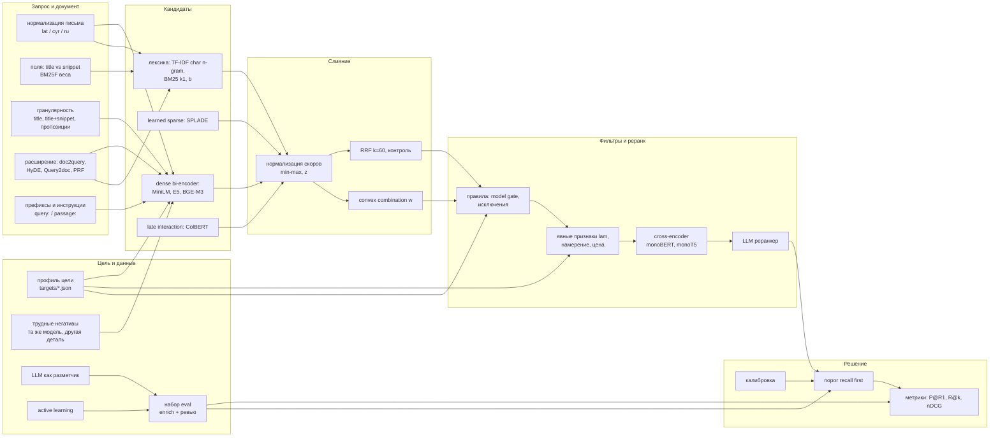

# Карта исследований: гибридный поиск «именно тот товар»

Что можно крутить в гибридном поиске, что из этого уже есть в репо, что мы уже намерили и какие гипотезы (H-xx в [`HYPOTHESES.md`](HYPOTHESES.md)) на что ставят. Цель исследований: **точный ретрив**, почти всегда находим то, что нужно (recall ≈ 1), и как можно меньше лишнего.

Метрики точного ретрива (считаются в `eval/plots.py`, таблица в каждом `results/<base>/plots.md` и в `metrics.ranking` результата):

| метрика | что значит | когда главная |
|---|---|---|
| P@R1, P@R95 | precision на той глубине списка, где recall впервые 1.0 (0.95) | монитор: пропуск хуже лишнего уведомления (ADR-0002) |
| R@k, R@npos, R@2npos | recall, если прочитать первые k (столько, сколько позитивов, вдвое больше) | бюджет внимания человека или реранкера |
| depth@R1 | сколько объявлений прочитать, чтобы увидеть все нужные | то же, в штуках |
| nDCG@npos, AP, MRR | качество порядка (Järvelin, Kekäläinen 2002) | когда важен порядок выдачи, а не только порог |
| FP при R 1.0, P/R real only, 5-fold | как в sweep (ADR-0013) | всегда рядом, чтобы не обмануться подгонкой порога |

## Схема факторов

## Факторы

Колонка «у нас сейчас» про код этого репо, «намерено» только с числами из реальных прогонов (источник указан).

| # | фактор | варианты | у нас сейчас | намерено | гипотезы |
|---|---|---|---|---|---|
| 1 | лексика | TF-IDF char 3..5, BM25 word (k1, b), BM25F по полям | TF-IDF в мониторе, BM25 k1 1.5 b 0.75 в `eval/sweep.py` | 430 строк, прогон Лёни ca9820f: hybrid tfidf P 0.667, bm25 P 0.558 при R 1.0 | H-06, H-10, H-16, H-19 |
| 2 | learned sparse | SPLADE, SPLADE v2 | нет | нет | H-19 |
| 3 | dense модель | MiniLM (paraphrase-multilingual), multilingual E5, BGE-M3, Contriever | MiniLM, выключен по умолчанию (ADR-0007) | ca9820f: MiniLM pure P 0.239 при R 1.0, 153 FP, depth@R1 310 из 430 | H-01, H-17, H-23, H-28 |
| 4 | префиксы и инструкции | `query:` / `passage:` у E5, инструкции у INSTRUCTOR | нет (MiniLM без префиксов) | нет | H-17 |
| 5 | нормализация текста | транслит lat / cyr / ru в одно | `a2179/normalize.py` везде | нет ablation | H-10 |
| 6 | слияние | convex combination с весом w, RRF (k 60), нормализация min-max | sweep: lin w 0..1 шаг 0.1, RRF как контроль | ca9820f hybrid: lin(dense,bm25) w 0.8 P 0.667 против rrf(dense,bm25) P 0.600 | H-14, H-26 |
| 7 | явные признаки | +1 экран, −1 за каждую группу «другая деталь, аксессуар, сервис, ищу», вес lam | sweep: (1−lam)·base + lam·feat | ca9820f hybrid: tfidf+feat lam 0.4 P 0.857 (8 FP) против tfidf P 0.667 (24 FP) | H-15, H-25, H-27 |
| 8 | правила как фильтр | model gate, исключения, intent, цена | профиль цели (ADR-0010), gate в каждом канале | regex один: P 0.939 R 0.958 (3 FP, 2 FN) | H-02, H-05, H-09, H-25 |
| 9 | реранк | cross-encoder (monoBERT, monoT5, mMARCO multilingual), LLM реранкер | нет | нет | H-04, H-12, H-13, H-22 |
| 10 | расширение запроса и документа | doc2query, HyDE, Query2doc, PRF | нет (прототипы руками) | нет | H-20 |
| 11 | гранулярность и поля | title, title+snippet, пропозиции, вес title | title+snippet одной строкой, признаки «чужих» групп только по title | нет | H-16, H-24 |
| 12 | трудные негативы и дообучение | ANCE, RocketQA (denoised), SetFit few shot | нет | нет | H-18 |
| 13 | порог и калибровка | recall first по набору, temperature или Platt | recall first, 2 и 5 fold (ADR-0013) | пороги tfidf hybrid: 0.38/0.18 по 99 строкам дают на 430 P 0.800 R 1.0 (eval_report ca9820f) | H-03, H-21 |
| 14 | данные и разметка | ревью авто меток, второй разметчик, LLM судья, active learning, ESCI метки | enrich + ревью человеком (ADR-0014) | 331 кандидат прочитан, 3 метки поправлены (3b678fa) | H-07, H-08, H-22, H-27, H-29 |
| 15 | перенос на другую цель | профиль, пороги, бенчмарки | профили (ADR-0010) | нет второй цели | H-02, H-03, H-28 |

## Взаимодействия факторов (что не складывается просто так)

- **Правила и реранкер подменяют друг друга** (H-25): model gate и признак lam уже выкидывают «другую деталь той же модели», ровно то, на чём реранкер даёт выигрыш. Ждём, что прирост реранкера поверх gate + feat меньше половины прироста без них.
- **Качество dense двигает вес слияния** (H-26): в `lin(dense,bm25)` вес w у dense. На 430 строках (ca9820f) pure оптимум w 0.1 (почти чистый BM25), а hybrid w 0.8: когда regex и gate уже отрезали чужие модели, dense вдруг полезнее лексики. Значит оптимум w зависит не только от модели, но и от того, что стоит перед слиянием. С моделью получше pure оптимум должен уехать к dense. Если не уезжает, проблема в постановке (тема против товара, H-01), а не в модели.
- **Слияние и нормализация**: Bruch et al. нашли, что CC обгоняет RRF, RRF чувствителен к своим параметрам, а CC мало зависит от выбора нормализации и настраивается на малом наборе. Проверяем на наших данных (H-14), учитывая, что у нас gate и regex сверху.
- **Префикс и гранулярность**: префиксы E5 рассчитаны на асимметрию короткий запрос, длинный пассаж. Наши «запросы» это прототипы, «документы» короткие заголовки, асимметрия слабая, эффект префикса может пропасть (H-17, H-24).
- **Расширение против точности**: doc2query и HyDE поднимают recall лексики, но добавляют темы вокруг товара, а это наш главный источник FP (other_model, 09_errors_by_kind). Ждём рост R@npos и риск по P@R1, меряем оба (H-20).
- **Разметка задаёт потолок**: если κ двух людей ниже 0.8 (H-07), все приросты меньше разброса разметки ничего не значат. Поэтому H-07 идёт до тонких сравнений.
- **Синтетика и пороги**: синтетика завышает (H-08), пороги, подобранные на ней, не переносятся (H-03, H-21). Решения по порогам только по real only строкам и 5-fold.
- **Бенчмарки и наша задача** (H-28): MTEB и BEIR меряют тематическую релевантность, у нас «тот же товар против той же темы», ранги моделей могут не совпасть.

## Источники

Каждая ссылка проверена 2026-11-19: страница `arxiv.org/abs/<id>` отвечает 200, название и первый автор сверены через arXiv API, DOI через Crossref. Без выдуманных цифр из статей: сюда переписаны только формулировки из аннотаций.

### Лексика, слияние, метрики (не arXiv)
- Robertson, Zaragoza. The Probabilistic Relevance Framework: BM25 and Beyond. Foundations and Trends in IR, 2009. https://doi.org/10.1561/1500000019
- Robertson, Zaragoza, Taylor. Simple BM25 extension to multiple weighted fields (BM25F). CIKM 2004. https://doi.org/10.1145/1031171.1031181
- Cormack, Clarke, Buettcher. Reciprocal rank fusion outperforms condorcet and individual rank learning methods. SIGIR 2009. https://doi.org/10.1145/1571941.1572114
- Järvelin, Kekäläinen. Cumulated gain-based evaluation of IR techniques (nDCG). ACM TOIS 2002. https://doi.org/10.1145/582415.582418

### Слияние и гибрид
- Bruch et al. An Analysis of Fusion Functions for Hybrid Retrieval. https://arxiv.org/abs/2210.11934
- Ma et al. A Replication Study of Dense Passage Retriever (BM25 baseline и dense–sparse гибрид сильнее, чем в оригинале). https://arxiv.org/abs/2104.05740

### Dense и late interaction
- Reimers, Gurevych. Sentence-BERT: Sentence Embeddings using Siamese BERT-Networks. https://arxiv.org/abs/1908.10084
- Karpukhin et al. Dense Passage Retrieval for Open-Domain Question Answering. https://arxiv.org/abs/2004.04906
- Izacard et al. Unsupervised Dense Information Retrieval with Contrastive Learning (Contriever). https://arxiv.org/abs/2112.09118
- Wang et al. Text Embeddings by Weakly-Supervised Contrastive Pre-training (E5, префиксы query / passage). https://arxiv.org/abs/2212.03533
- Wang et al. Multilingual E5 Text Embeddings: A Technical Report. https://arxiv.org/abs/2402.05672
- Su et al. One Embedder, Any Task: Instruction-Finetuned Text Embeddings (INSTRUCTOR). https://arxiv.org/abs/2212.09741
- Chen et al. M3-Embedding: Multi-Linguality, Multi-Functionality, Multi-Granularity Text Embeddings Through Self-Knowledge Distillation (BGE-M3). https://arxiv.org/abs/2402.03216
- Khattab, Zaharia. ColBERT: Efficient and Effective Passage Search via Contextualized Late Interaction over BERT. https://arxiv.org/abs/2004.12832
- Santhanam et al. ColBERTv2: Effective and Efficient Retrieval via Lightweight Late Interaction. https://arxiv.org/abs/2112.01488

### Learned sparse
- Formal et al. SPLADE: Sparse Lexical and Expansion Model for First Stage Ranking. https://arxiv.org/abs/2107.05720
- Formal et al. SPLADE v2: Sparse Lexical and Expansion Model for Information Retrieval. https://arxiv.org/abs/2109.10086

### Реранк
- Nogueira, Cho. Passage Re-ranking with BERT (monoBERT). https://arxiv.org/abs/1901.04085
- Nogueira et al. Document Ranking with a Pretrained Sequence-to-Sequence Model (monoT5). https://arxiv.org/abs/2003.06713
- Bonifacio et al. mMARCO: A Multilingual Version of the MS MARCO Passage Ranking Dataset. https://arxiv.org/abs/2108.13897
- Sun et al. Is ChatGPT Good at Search? Investigating Large Language Models as Re-Ranking Agents (RankGPT). https://arxiv.org/abs/2304.09542

### Расширение запроса и документа
- Nogueira et al. Document Expansion by Query Prediction (doc2query). https://arxiv.org/abs/1904.08375
- Gao et al. Precise Zero-Shot Dense Retrieval without Relevance Labels (HyDE). https://arxiv.org/abs/2212.10496
- Wang et al. Query2doc: Query Expansion with Large Language Models. https://arxiv.org/abs/2303.07678
- Yu et al. Improving Query Representations for Dense Retrieval with Pseudo Relevance Feedback (ANCE-PRF). https://arxiv.org/abs/2108.13454
- Chen et al. Dense X Retrieval: What Retrieval Granularity Should We Use? (пропозиции). https://arxiv.org/abs/2312.06648

### Трудные негативы, дообучение, калибровка
- Xiong et al. Approximate Nearest Neighbor Negative Contrastive Learning for Dense Text Retrieval (ANCE). https://arxiv.org/abs/2007.00808
- Qu et al. RocketQA: An Optimized Training Approach to Dense Passage Retrieval for Open-Domain Question Answering (denoised hard negatives). https://arxiv.org/abs/2010.08191
- Tunstall et al. Efficient Few-Shot Learning Without Prompts (SetFit). https://arxiv.org/abs/2209.11055
- Guo et al. On Calibration of Modern Neural Networks (temperature scaling). https://arxiv.org/abs/1706.04599

### Товары, сопоставление, разметка, бенчмарки
- Reddy et al. Shopping Queries Dataset: A Large-Scale ESCI Benchmark for Improving Product Search (метки Exact, Substitute, Complement, Irrelevant). https://arxiv.org/abs/2206.06588
- Li et al. Deep Entity Matching with Pre-Trained Language Models (Ditto). https://arxiv.org/abs/2004.00584
- Thomas et al. Large language models can accurately predict searcher preferences (LLM как разметчик). https://arxiv.org/abs/2309.10621
- Cormack, Grossman. Autonomy and Reliability of Continuous Active Learning for Technology-Assisted Review (high recall review). https://arxiv.org/abs/1504.06868
- Thakur et al. BEIR: A Heterogenous Benchmark for Zero-shot Evaluation of Information Retrieval Models. https://arxiv.org/abs/2104.08663
- Muennighoff et al. MTEB: Massive Text Embedding Benchmark. https://arxiv.org/abs/2210.07316

### EDA и графики
Подход графиков в `eval/plots.py`: разведочный анализ по Tukey (Exploratory Data Analysis, 1977), small multiples по Tufte (The Visual Display of Quantitative Information, 1983). Пример курса MIT: OCW 11.220 Quantitative Reasoning & Statistical Methods for Planners I (Ezra Haber Glenn, весна 2009), лекция 6 «Exploratory data analysis and visualization» и лекция 21 про lattice plots: https://ocw.mit.edu/courses/11-220-quantitative-reasoning-statistical-methods-for-planners-i-spring-2009/pages/lecture-notes/
