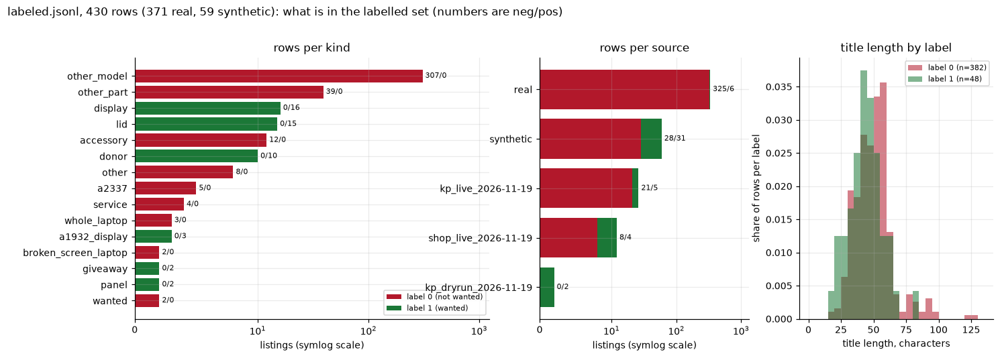
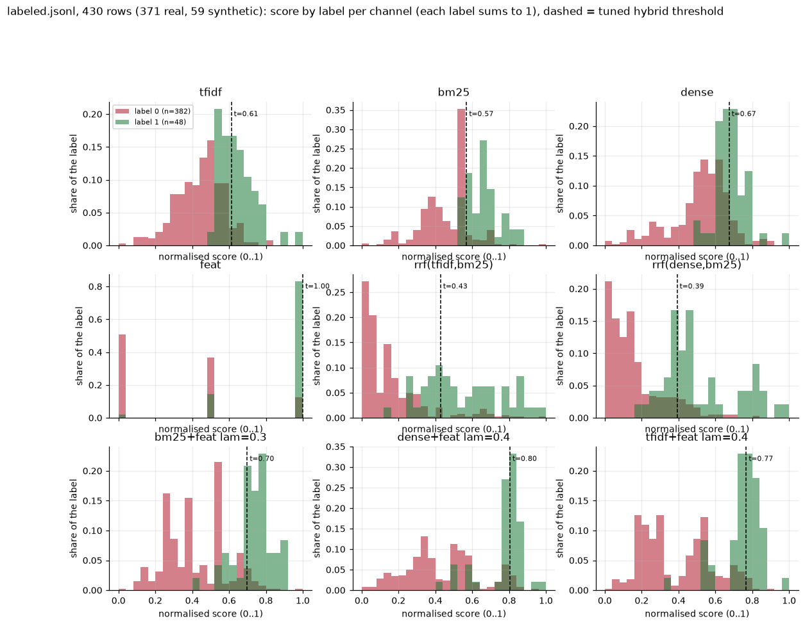
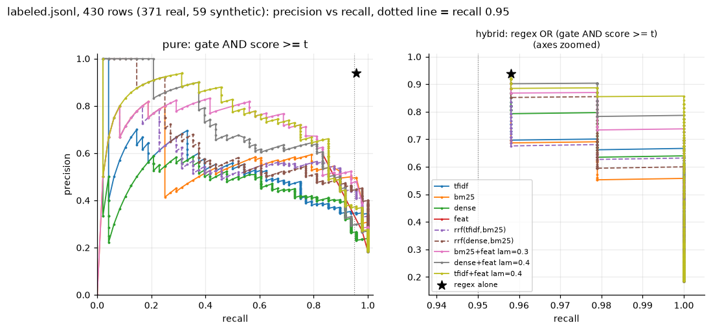
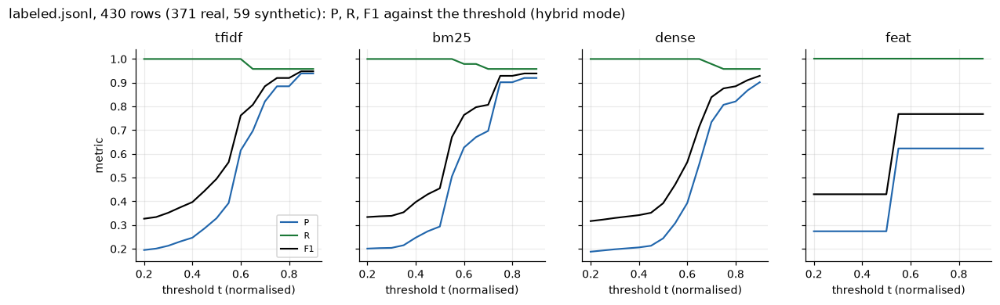
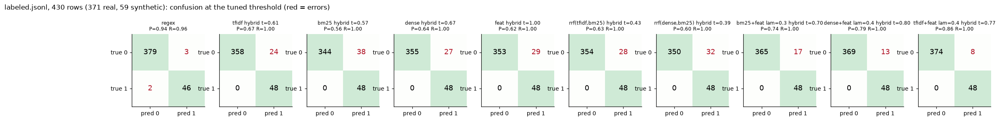
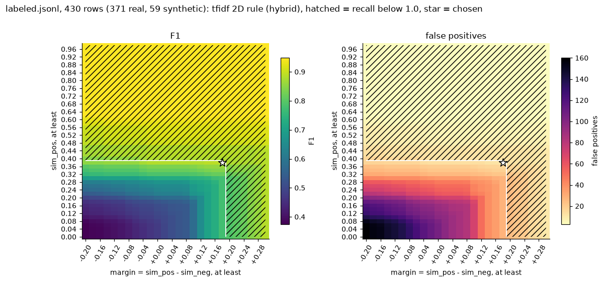
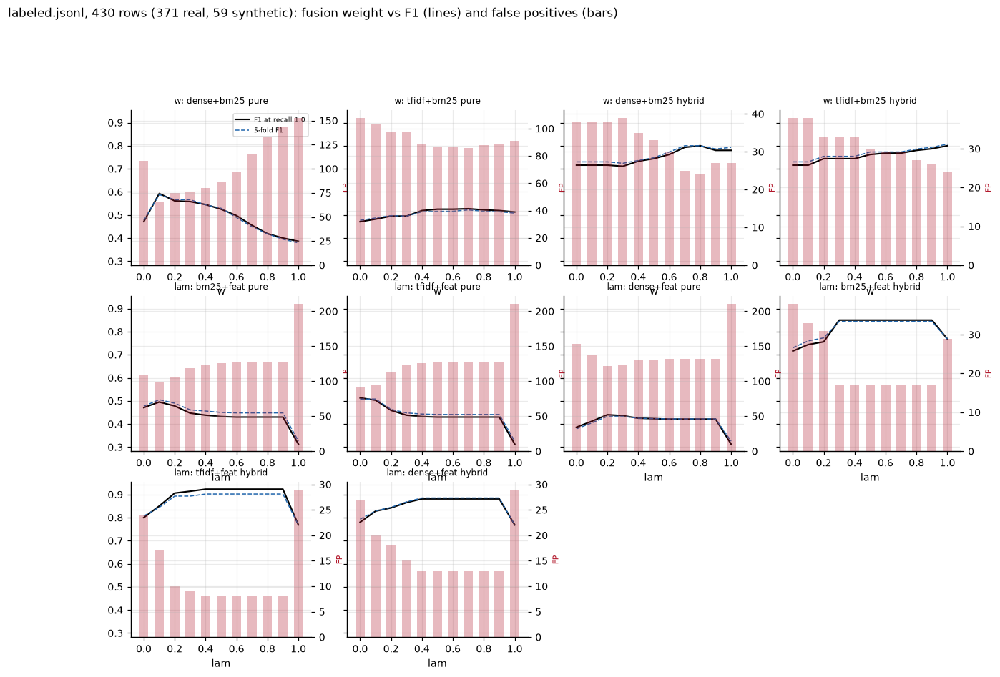
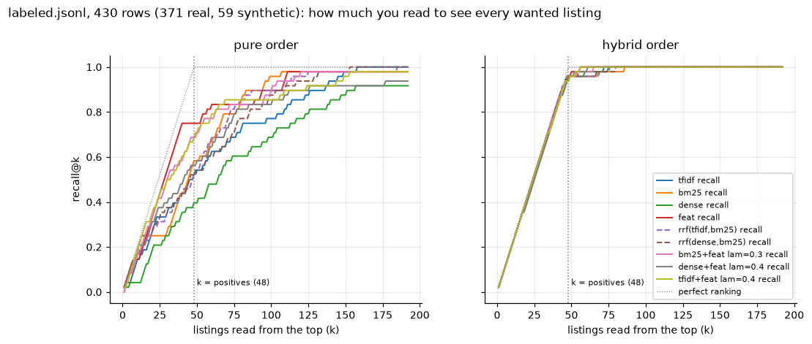
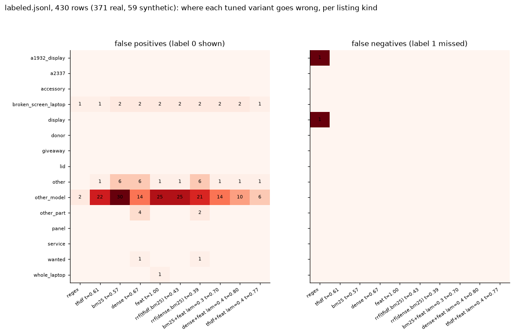

<!-- generated by python eval/plots.py, do not edit by hand -->

## Charts: labeled.jsonl, 430 rows (371 real, 59 synthetic)

### Ranking metrics (read the list from the top)

48 positives. pure = sorted by the score alone, hybrid = regex hits first, then rows the model gate lets through by score. R@n = recall after reading n listings, P@R1 / P@R95 = precision at the depth where recall reaches 1.0 / 0.95, depth@R1 = listings read to see all positives.

| channel | order | R@npos | R@2npos | P@R95 | P@R1 | depth@R1 | AP | nDCG@npos |
|---|---|---|---|---|---|---|---|---|
| tfidf | pure | 0.521 | 0.750 | 0.317 | 0.304 | 158 | 0.522 | 0.562 |
| tfidf | hybrid | 0.958 | 1.000 | 0.979 | 0.667 | 72 | 0.985 | 0.971 |
| bm25 | pure | 0.583 | 0.938 | 0.465 | 0.216 | 222 | 0.568 | 0.578 |
| bm25 | hybrid | 0.958 | 1.000 | 0.979 | 0.558 | 86 | 0.983 | 0.971 |
| dense | pure | 0.396 | 0.667 | 0.172 | 0.155 | 310 | 0.363 | 0.403 |
| dense | hybrid | 0.958 | 1.000 | 0.958 | 0.640 | 75 | 0.967 | 0.967 |
| feat | pure | 0.750 | 0.896 | 0.418 | 0.198 | 243 | 0.767 | 0.788 |
| feat | hybrid | 0.938 | 1.000 | 0.939 | 0.857 | 56 | 0.989 | 0.956 |
| rrf(tfidf,bm25) | pure | 0.521 | 0.896 | 0.404 | 0.259 | 185 | 0.579 | 0.569 |
| rrf(tfidf,bm25) | hybrid | 0.958 | 1.000 | 0.979 | 0.632 | 76 | 0.985 | 0.971 |
| rrf(dense,bm25) | pure | 0.521 | 0.833 | 0.357 | 0.314 | 153 | 0.612 | 0.609 |
| rrf(dense,bm25) | hybrid | 0.958 | 1.000 | 0.979 | 0.600 | 80 | 0.979 | 0.970 |
| bm25+feat lam=0.3 | pure | 0.688 | 0.875 | 0.397 | 0.220 | 218 | 0.686 | 0.683 |
| bm25+feat lam=0.3 | hybrid | 0.938 | 1.000 | 0.939 | 0.738 | 65 | 0.987 | 0.956 |
| dense+feat lam=0.4 | pure | 0.562 | 0.833 | 0.228 | 0.203 | 237 | 0.608 | 0.627 |
| dense+feat lam=0.4 | hybrid | 0.938 | 1.000 | 0.939 | 0.787 | 61 | 0.972 | 0.953 |
| tfidf+feat lam=0.4 | pure | 0.688 | 0.854 | 0.309 | 0.207 | 232 | 0.720 | 0.726 |
| tfidf+feat lam=0.4 | hybrid | 0.938 | 1.000 | 0.939 | 0.857 | 56 | 0.988 | 0.956 |

### 01_dataset

What the labelled set holds: rows per kind and source split by label, title length by label.

### 02_score_hist

Raw score distribution by label per channel. Overlap = rows no threshold can separate.

### 03_pr_curves

Precision against recall when the threshold slides. Star = regex alone.

### 04_threshold

How P, R and F1 move with the threshold (hybrid). The flat P line is where the regex dominates.

### 05_confusion

Confusion matrix per variant at the threshold the sweep picked (recall first).

### 06_tfidf_2d

The monitor's own tfidf rule over its full grid: how pos and margin interact. Hatched cells miss a positive, the white line bounds recall 1.0, the star is the setting the sweep picked.

### 07_fusion_weights

Fusion weight against F1 (black), 5-fold F1 (blue dashed) and false positives (bars).

### 08_recall_budget

Recall when you read the top k listings. The dotted line is k = number of positives.

### 09_errors_by_kind

Errors per listing kind, which kinds each channel confuses with the product.

