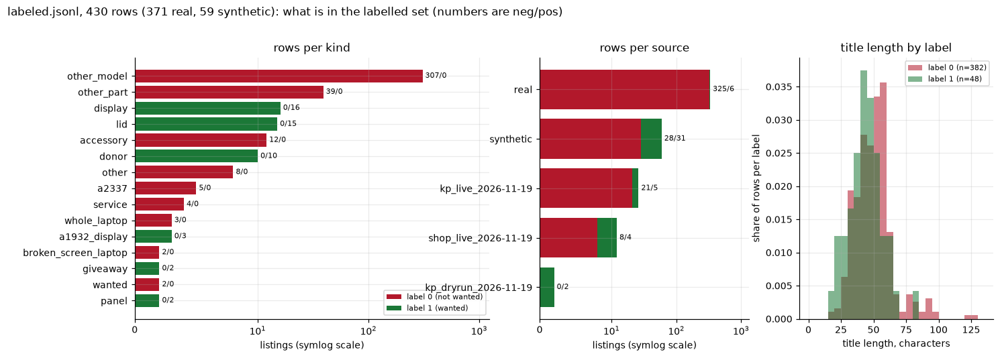
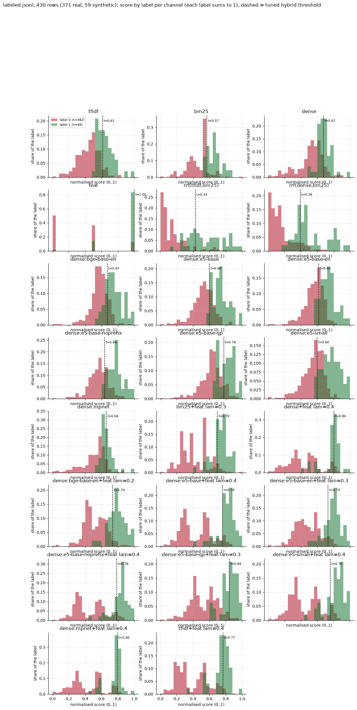
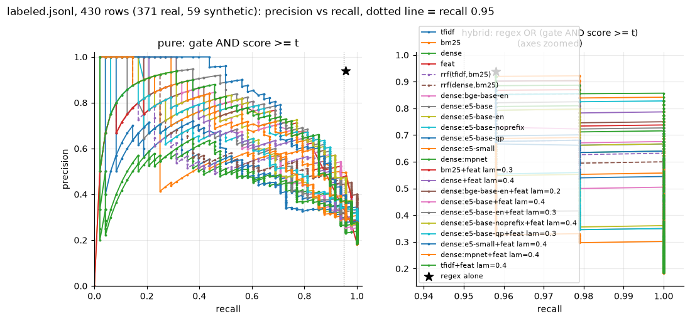
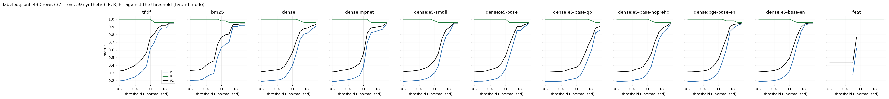
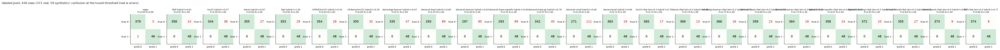
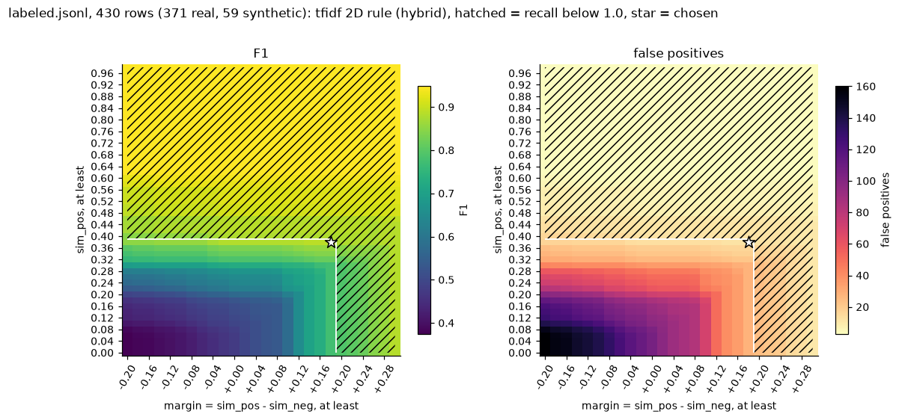
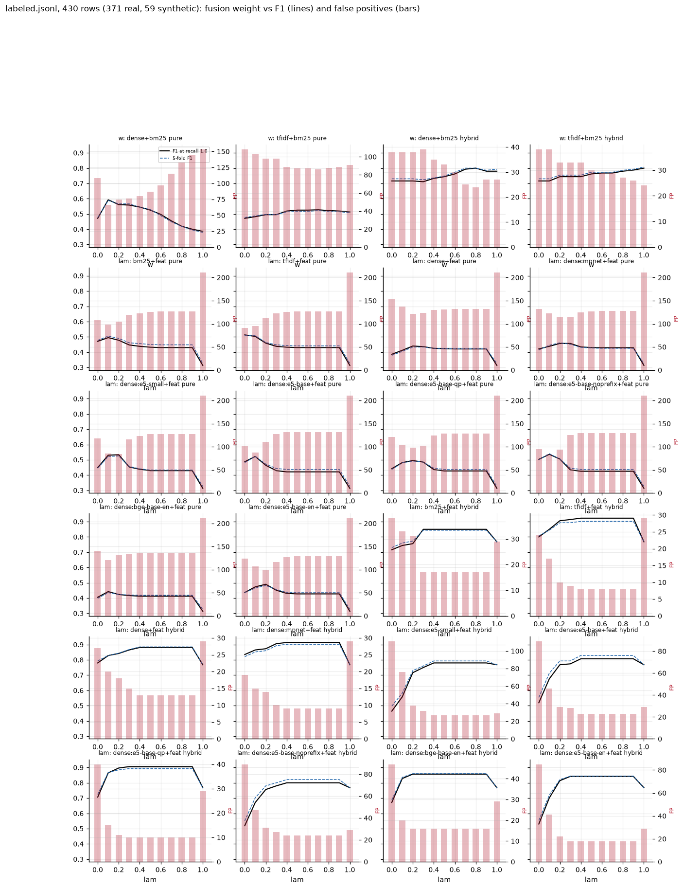
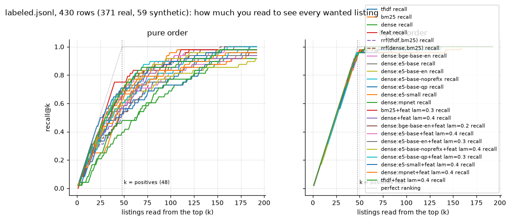
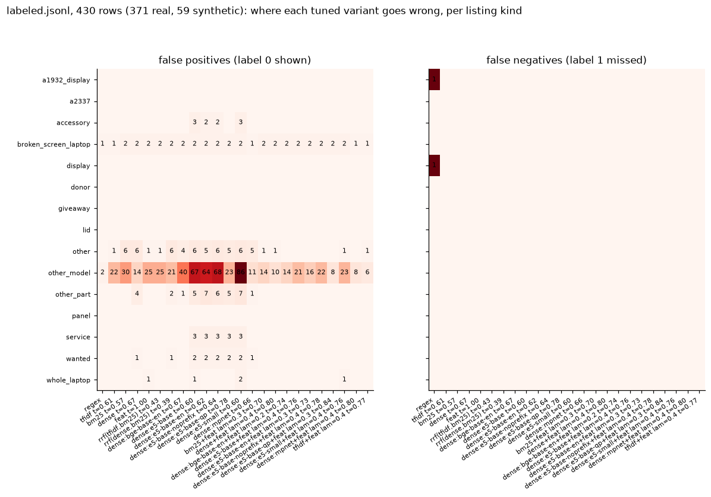

<!-- generated by python eval/sweep.py (2026-11-20 00:00 CET), do not edit by hand -->

### Variants, best threshold each (recall first)

| variant | mode | threshold | P | R | F1 | FP | FN | 2-fold P/R | 5-fold P/R | real rows only P/R | error ids |
|---|---|---|---|---|---|---|---|---|---|---|---|
| regex | pure | | 0.939 | 0.958 | 0.948 | 3 | 2 | | | | 62, 96, 107, 119, 120 |
| tfidf (d=pos-neg) | pure | 0.5095 | 0.345 | 1.000 | 0.513 | 91 | 0 | 0.346/0.979 | 0.343/0.979 | 0.170/1.000 (fp 83, fn 0) | 5, 7, 75, 79, 88, 90, 92, 93, 94, 96, 100, 101 … |
| bm25 (d=pos-neg) | pure | 0.5232 | 0.308 | 1.000 | 0.471 | 108 | 0 | 0.343/0.979 | 0.315/0.979 | 0.148/1.000 (fp 98, fn 0) | 5, 7, 9, 16, 75, 79, 80, 87, 88, 90, 92, 93 … |
| dense (d=pos-neg) | pure | 0.489 | 0.239 | 1.000 | 0.386 | 153 | 0 | 0.247/0.958 | 0.235/0.979 | 0.110/1.000 (fp 138, fn 0) | 2, 4, 5, 6, 7, 8, 9, 13, 16, 19, 22, 30 … |
| dense:mpnet (d=pos-neg) | pure | 0.5501 | 0.267 | 1.000 | 0.421 | 132 | 0 | 0.266/0.979 | 0.263/0.979 | 0.124/1.000 (fp 120, fn 0) | 2, 4, 5, 6, 7, 8, 14, 17, 30, 35, 74, 75 … |
| dense:e5-small (d=pos-neg) | pure | 0.5855 | 0.289 | 1.000 | 0.449 | 118 | 0 | 0.292/0.938 | 0.288/0.979 | 0.137/1.000 (fp 107, fn 0) | 2, 3, 4, 5, 7, 9, 19, 22, 30, 35, 74, 75 … |
| dense:e5-base (d=pos-neg) | pure | 0.5904 | 0.322 | 1.000 | 0.487 | 101 | 0 | 0.329/0.979 | 0.320/0.979 | 0.156/1.000 (fp 92, fn 0) | 2, 3, 5, 7, 8, 9, 16, 19, 22, 30, 75, 79 … |
| dense:e5-base-qp (d=pos-neg) | pure | 0.6614 | 0.284 | 1.000 | 0.442 | 121 | 0 | 0.288/0.917 | 0.281/0.979 | 0.133/1.000 (fp 111, fn 0) | 2, 3, 4, 5, 6, 7, 8, 9, 16, 19, 20, 30 … |
| dense:e5-base-noprefix (d=pos-neg) | pure | 0.6269 | 0.336 | 1.000 | 0.503 | 95 | 0 | 0.338/0.958 | 0.336/0.979 | 0.165/1.000 (fp 86, fn 0) | 3, 5, 7, 8, 9, 16, 19, 30, 75, 87, 88, 89 … |
| dense:bge-base-en (d=pos-neg) | pure | 0.5533 | 0.254 | 1.000 | 0.405 | 141 | 0 | 0.274/0.896 | 0.250/0.979 | 0.116/1.000 (fp 130, fn 0) | 2, 3, 5, 6, 7, 8, 9, 16, 19, 75, 79, 82 … |
| dense:e5-base-en (d=pos-neg) | pure | 0.563 | 0.279 | 1.000 | 0.436 | 124 | 0 | 0.286/0.958 | 0.280/0.979 | 0.131/1.000 (fp 113, fn 0) | 3, 5, 7, 8, 9, 19, 75, 79, 81, 83, 87, 88 … |
| feat only | pure | 0.0 | 0.185 | 1.000 | 0.313 | 211 | 0 | 0.217/0.979 | 0.196/0.979 | 0.081/1.000 (fp 193, fn 0) | 2, 3, 4, 5, 6, 7, 8, 9, 12, 13, 14, 15 … |
| lin(dense,bm25) w=0.1 | pure | 0.5383 | 0.421 | 1.000 | 0.593 | 66 | 0 | 0.434/0.958 | 0.420/0.979 | 0.227/1.000 (fp 58, fn 0) | 5, 7, 75, 79, 88, 90, 92, 93, 94, 96, 100, 101 … |
| rrf(dense,bm25) | pure | 0.1853 | 0.400 | 1.000 | 0.571 | 72 | 0 | 0.420/0.979 | 0.400/0.958 | 0.212/1.000 (fp 63, fn 0) | 5, 7, 35, 74, 75, 79, 88, 90, 92, 93, 94, 96 … |
| lin(tfidf,bm25) w=0.7 | pure | 0.5205 | 0.358 | 1.000 | 0.527 | 86 | 0 | 0.356/0.979 | 0.356/0.979 | 0.179/1.000 (fp 78, fn 0) | 5, 7, 75, 79, 88, 90, 92, 93, 94, 96, 100, 101 … |
| rrf(tfidf,bm25) | pure | 0.1523 | 0.333 | 1.000 | 0.500 | 96 | 0 | 0.373/0.979 | 0.341/0.979 | 0.162/1.000 (fp 88, fn 0) | 5, 7, 75, 79, 88, 90, 92, 93, 94, 96, 100, 101 … |
| bm25+feat lam=0.1 | pure | 0.5169 | 0.329 | 1.000 | 0.495 | 98 | 0 | 0.371/0.958 | 0.341/0.979 | 0.157/1.000 (fp 91, fn 0) | 75, 79, 88, 92, 93, 94, 96, 100, 101, 102, 103, 104 … |
| tfidf+feat lam=0.1 | pure | 0.5018 | 0.336 | 1.000 | 0.503 | 95 | 0 | 0.364/0.896 | 0.343/0.979 | 0.162/1.000 (fp 88, fn 0) | 75, 79, 88, 92, 93, 94, 96, 100, 101, 102, 103, 104 … |
| dense+feat lam=0.2 | pure | 0.4912 | 0.282 | 1.000 | 0.440 | 122 | 0 | 0.301/0.958 | 0.278/0.979 | 0.133/1.000 (fp 111, fn 0) | 2, 8, 9, 16, 19, 30, 35, 74, 75, 79, 88, 89 … |
| dense:mpnet+feat lam=0.2 | pure | 0.5401 | 0.296 | 1.000 | 0.457 | 114 | 0 | 0.338/0.979 | 0.301/0.979 | 0.140/1.000 (fp 104, fn 0) | 2, 30, 74, 75, 79, 88, 89, 90, 92, 93, 94, 96 … |
| dense:e5-small+feat lam=0.2 | pure | 0.6087 | 0.364 | 1.000 | 0.533 | 84 | 0 | 0.365/0.958 | 0.359/0.979 | 0.181/1.000 (fp 77, fn 0) | 2, 19, 30, 74, 75, 79, 88, 89, 92, 96, 100, 101 … |
| dense:e5-base+feat lam=0.1 | pure | 0.587 | 0.353 | 1.000 | 0.522 | 88 | 0 | 0.382/0.979 | 0.356/0.979 | 0.177/1.000 (fp 79, fn 0) | 2, 3, 5, 7, 19, 75, 79, 87, 88, 89, 92, 93 … |
| dense:e5-base-qp+feat lam=0.2 | pure | 0.6393 | 0.329 | 1.000 | 0.495 | 98 | 0 | 0.336/0.958 | 0.329/0.979 | 0.160/1.000 (fp 89, fn 0) | 2, 3, 5, 6, 7, 19, 30, 74, 75, 79, 87, 88 … |
| dense:e5-base-noprefix+feat lam=0.1 | pure | 0.6272 | 0.366 | 1.000 | 0.536 | 83 | 0 | 0.427/0.979 | 0.373/0.979 | 0.183/1.000 (fp 76, fn 0) | 7, 19, 75, 87, 88, 89, 92, 93, 96, 100, 101, 102 … |
| dense:bge-base-en+feat lam=0.1 | pure | 0.5553 | 0.284 | 1.000 | 0.442 | 121 | 0 | 0.323/0.896 | 0.280/0.979 | 0.132/1.000 (fp 112, fn 0) | 2, 5, 7, 19, 74, 75, 79, 88, 89, 92, 93, 94 … |
| dense:e5-base-en+feat lam=0.2 | pure | 0.5669 | 0.324 | 1.000 | 0.490 | 100 | 0 | 0.320/0.979 | 0.320/0.979 | 0.157/1.000 (fp 91, fn 0) | 5, 7, 19, 74, 75, 79, 88, 89, 92, 93, 94, 96 … |
| tfidf (d=pos-neg) | hybrid | 0.6121 | 0.667 | 1.000 | 0.800 | 24 | 0 | 0.671/0.979 | 0.697/0.958 | 0.425/1.000 (fp 23, fn 0) | 96, 100, 101, 102, 103, 104, 105, 106, 108, 109, 111, 119 … |
| bm25 (d=pos-neg) | hybrid | 0.5693 | 0.558 | 1.000 | 0.716 | 38 | 0 | 0.610/0.979 | 0.590/0.958 | 0.321/1.000 (fp 36, fn 0) | 75, 96, 100, 101, 102, 103, 104, 105, 106, 108, 109, 111 … |
| dense (d=pos-neg) | hybrid | 0.6745 | 0.640 | 1.000 | 0.780 | 27 | 0 | 0.701/0.979 | 0.676/0.958 | 0.425/1.000 (fp 23, fn 0) | 75, 88, 90, 96, 103, 106, 111, 119, 120, 132, 150, 164 … |
| dense:mpnet (d=pos-neg) | hybrid | 0.6587 | 0.716 | 1.000 | 0.835 | 19 | 0 | 0.783/0.979 | 0.719/0.958 | 0.515/1.000 (fp 16, fn 0) | 88, 90, 96, 104, 106, 119, 120, 132, 146, 164, 165, 166 … |
| dense:e5-small (d=pos-neg) | hybrid | 0.5982 | 0.302 | 1.000 | 0.464 | 111 | 0 | 0.322/0.979 | 0.336/0.958 | 0.143/1.000 (fp 102, fn 0) | 2, 3, 4, 5, 7, 9, 19, 22, 30, 35, 74, 75 … |
| dense:e5-base (d=pos-neg) | hybrid | 0.6005 | 0.350 | 1.000 | 0.519 | 89 | 0 | 0.382/0.979 | 0.390/0.958 | 0.173/1.000 (fp 81, fn 0) | 2, 3, 5, 7, 8, 9, 16, 19, 22, 75, 87, 88 … |
| dense:e5-base-qp (d=pos-neg) | hybrid | 0.777 | 0.545 | 1.000 | 0.706 | 40 | 0 | 0.618/0.979 | 0.582/0.958 | 0.333/1.000 (fp 34, fn 0) | 3, 5, 6, 7, 9, 19, 75, 87, 88, 89, 93, 96 … |
| dense:e5-base-noprefix (d=pos-neg) | hybrid | 0.638 | 0.350 | 1.000 | 0.519 | 89 | 0 | 0.439/0.979 | 0.387/0.958 | 0.172/1.000 (fp 82, fn 0) | 3, 5, 7, 8, 9, 16, 19, 30, 75, 87, 88, 89 … |
| dense:bge-base-en (d=pos-neg) | hybrid | 0.6713 | 0.505 | 1.000 | 0.671 | 47 | 0 | 0.635/0.979 | 0.535/0.958 | 0.283/1.000 (fp 43, fn 0) | 75, 92, 93, 96, 100, 101, 102, 104, 105, 108, 109, 119 … |
| dense:e5-base-en (d=pos-neg) | hybrid | 0.6177 | 0.361 | 1.000 | 0.530 | 85 | 0 | 0.409/0.979 | 0.390/0.958 | 0.185/1.000 (fp 75, fn 0) | 3, 5, 7, 8, 9, 19, 75, 79, 81, 87, 88, 89 … |
| feat only | hybrid | 1.0 | 0.623 | 1.000 | 0.768 | 29 | 0 | 0.623/1.000 | 0.623/1.000 | 0.405/1.000 (fp 25, fn 0) | 74, 75, 92, 96, 101, 106, 109, 111, 119, 120, 132, 133 … |
| lin(dense,bm25) w=0.8 | hybrid | 0.6534 | 0.667 | 1.000 | 0.800 | 24 | 0 | 0.723/0.979 | 0.687/0.958 | 0.459/1.000 (fp 20, fn 0) | 75, 88, 90, 96, 101, 103, 106, 111, 119, 120, 132, 136 … |
| rrf(dense,bm25) | hybrid | 0.392 | 0.600 | 1.000 | 0.750 | 32 | 0 | 0.712/0.979 | 0.630/0.958 | 0.378/1.000 (fp 28, fn 0) | 75, 88, 90, 96, 101, 102, 103, 104, 105, 106, 108, 111 … |
| lin(tfidf,bm25) w=1.0 | hybrid | 0.6121 | 0.667 | 1.000 | 0.800 | 24 | 0 | 0.671/0.979 | 0.697/0.958 | 0.425/1.000 (fp 23, fn 0) | 96, 100, 101, 102, 103, 104, 105, 106, 108, 109, 111, 119 … |
| rrf(tfidf,bm25) | hybrid | 0.4282 | 0.632 | 1.000 | 0.774 | 28 | 0 | 0.653/0.979 | 0.657/0.958 | 0.395/1.000 (fp 26, fn 0) | 75, 96, 100, 101, 102, 103, 104, 105, 106, 108, 109, 111 … |
| bm25+feat lam=0.3 | hybrid | 0.6985 | 0.738 | 1.000 | 0.850 | 17 | 0 | 0.783/0.979 | 0.754/0.958 | 0.531/1.000 (fp 15, fn 0) | 75, 96, 101, 106, 109, 111, 119, 120, 132, 133, 136, 137 … |
| tfidf+feat lam=0.4 | hybrid | 0.7673 | 0.857 | 1.000 | 0.923 | 8 | 0 | 0.855/0.979 | 0.852/0.958 | 0.708/1.000 (fp 7, fn 0) | 96, 101, 106, 109, 111, 119, 120, 133 |
| dense+feat lam=0.4 | hybrid | 0.8047 | 0.787 | 1.000 | 0.881 | 13 | 0 | 0.839/0.979 | 0.821/0.958 | 0.607/1.000 (fp 11, fn 0) | 75, 96, 106, 111, 119, 120, 132, 150, 167, 171, 225, 243 … |
| dense:mpnet+feat lam=0.4 | hybrid | 0.7952 | 0.842 | 1.000 | 0.914 | 9 | 0 | 0.904/0.979 | 0.852/0.958 | 0.680/1.000 (fp 8, fn 0) | 96, 106, 119, 120, 132, 146, 171, 204, 225 |
| dense:e5-small+feat lam=0.4 | hybrid | 0.7589 | 0.640 | 1.000 | 0.780 | 27 | 0 | 0.653/0.979 | 0.676/0.958 | 0.425/1.000 (fp 23, fn 0) | 74, 75, 92, 96, 101, 106, 109, 111, 119, 120, 132, 133 … |
| dense:e5-base+feat lam=0.4 | hybrid | 0.7603 | 0.676 | 1.000 | 0.807 | 23 | 0 | 0.701/0.979 | 0.730/0.958 | 0.459/1.000 (fp 20, fn 0) | 75, 92, 96, 101, 109, 119, 120, 132, 133, 137, 146, 150 … |
| dense:e5-base-qp+feat lam=0.3 | hybrid | 0.8439 | 0.828 | 1.000 | 0.906 | 10 | 0 | 0.839/0.979 | 0.836/0.958 | 0.680/1.000 (fp 8, fn 0) | 75, 96, 101, 119, 120, 132, 133, 153, 156, 171 |
| dense:e5-base-noprefix+feat lam=0.4 | hybrid | 0.7828 | 0.667 | 1.000 | 0.800 | 24 | 0 | 0.712/0.979 | 0.719/0.958 | 0.447/1.000 (fp 21, fn 0) | 75, 92, 96, 101, 106, 109, 119, 120, 132, 133, 137, 146 … |
| dense:bge-base-en+feat lam=0.2 | hybrid | 0.737 | 0.750 | 1.000 | 0.857 | 16 | 0 | 0.810/0.979 | 0.780/0.958 | 0.567/1.000 (fp 13, fn 0) | 75, 92, 96, 101, 109, 119, 120, 132, 133, 150, 153, 167 … |
| dense:e5-base-en+feat lam=0.3 | hybrid | 0.7324 | 0.727 | 1.000 | 0.842 | 18 | 0 | 0.770/0.979 | 0.754/0.958 | 0.515/1.000 (fp 16, fn 0) | 75, 96, 101, 106, 109, 119, 120, 132, 133, 136, 137, 146 … |

Dense channel: ci_out/sweep/dense_scores.jsonl

### tfidf, the monitor's own 2D rule (hybrid), one step at a time

| pos (margin 0.18) | P | R | FP | FN |
|---|---|---|---|---|
| 0.28 | 0.632 | 1.000 | 28 | 0 |
| 0.30 | 0.632 | 1.000 | 28 | 0 |
| 0.32 | 0.686 | 1.000 | 22 | 0 |
| 0.34 | 0.727 | 1.000 | 18 | 0 |
| 0.36 | 0.750 | 1.000 | 16 | 0 |
| 0.38 | 0.800 | 1.000 | 12 | 0 |
| 0.40 | 0.797 | 0.979 | 12 | 1 |
| 0.42 | 0.810 | 0.979 | 11 | 1 |
| 0.44 | 0.810 | 0.979 | 11 | 1 |
| 0.46 | 0.821 | 0.958 | 10 | 2 |
| 0.48 | 0.868 | 0.958 | 7 | 2 |
| 0.50 | 0.868 | 0.958 | 7 | 2 |

| margin (pos 0.38) | P | R | FP | FN |
|---|---|---|---|---|
| -0.04 | 0.774 | 1.000 | 14 | 0 |
| -0.02 | 0.787 | 1.000 | 13 | 0 |
| +0.00 | 0.787 | 1.000 | 13 | 0 |
| +0.02 | 0.787 | 1.000 | 13 | 0 |
| +0.04 | 0.787 | 1.000 | 13 | 0 |
| +0.06 | 0.787 | 1.000 | 13 | 0 |
| +0.08 | 0.787 | 1.000 | 13 | 0 |
| +0.10 | 0.787 | 1.000 | 13 | 0 |
| +0.12 | 0.787 | 1.000 | 13 | 0 |
| +0.14 | 0.800 | 1.000 | 12 | 0 |
| +0.16 | 0.800 | 1.000 | 12 | 0 |
| +0.18 | 0.800 | 1.000 | 12 | 0 |
| +0.20 | 0.797 | 0.979 | 12 | 1 |
| +0.22 | 0.797 | 0.979 | 12 | 1 |
| +0.24 | 0.797 | 0.979 | 12 | 1 |
| +0.26 | 0.807 | 0.958 | 11 | 2 |
| +0.28 | 0.821 | 0.958 | 10 | 2 |
| +0.30 | 0.821 | 0.958 | 10 | 2 |

Best 2D: pure {'pos': 0.2, 'margin': 0.02, 'P': 0.41, 'R': 1.0, 'F1': 0.582, 'tp': 48, 'fp': 69, 'fn': 0, 'tn': 313}, hybrid {'pos': 0.38, 'margin': 0.18, 'P': 0.8, 'R': 1.0, 'F1': 0.889, 'tp': 48, 'fp': 12, 'fn': 0, 'tn': 370}

### Normalised scalar threshold steps (hybrid)

| t | tfidf P/R (FP,FN) | bm25 P/R (FP,FN) | dense P/R (FP,FN) | dense:mpnet P/R (FP,FN) | dense:e5-small P/R (FP,FN) | dense:e5-base P/R (FP,FN) | dense:e5-base-qp P/R (FP,FN) | dense:e5-base-noprefix P/R (FP,FN) | dense:bge-base-en P/R (FP,FN) | dense:e5-base-en P/R (FP,FN) | feat P/R (FP,FN) |
|---|---|---|---|---|---|---|---|---|---|---|---|
| 0.20 | 0.195/1.000 (198,0) | 0.201/1.000 (191,0) | 0.188/1.000 (207,0) | 0.187/1.000 (209,0) | 0.188/1.000 (208,0) | 0.187/1.000 (209,0) | 0.186/1.000 (210,0) | 0.186/1.000 (210,0) | 0.187/1.000 (209,0) | 0.187/1.000 (209,0) | 0.274/1.000 (127,0) |
| 0.25 | 0.201/1.000 (191,0) | 0.203/1.000 (189,0) | 0.193/1.000 (201,0) | 0.190/1.000 (204,0) | 0.192/1.000 (202,0) | 0.190/1.000 (205,0) | 0.186/1.000 (210,0) | 0.188/1.000 (207,0) | 0.187/1.000 (209,0) | 0.189/1.000 (206,0) | 0.274/1.000 (127,0) |
| 0.30 | 0.213/1.000 (177,0) | 0.204/1.000 (187,0) | 0.198/1.000 (195,0) | 0.200/1.000 (192,0) | 0.194/1.000 (200,0) | 0.190/1.000 (205,0) | 0.188/1.000 (208,0) | 0.190/1.000 (205,0) | 0.189/1.000 (206,0) | 0.190/1.000 (204,0) | 0.274/1.000 (127,0) |
| 0.35 | 0.231/1.000 (160,0) | 0.215/1.000 (175,0) | 0.202/1.000 (190,0) | 0.204/1.000 (187,0) | 0.199/1.000 (193,0) | 0.196/1.000 (197,0) | 0.189/1.000 (206,0) | 0.192/1.000 (202,0) | 0.192/1.000 (202,0) | 0.195/1.000 (198,0) | 0.274/1.000 (127,0) |
| 0.40 | 0.247/1.000 (146,0) | 0.247/1.000 (146,0) | 0.206/1.000 (185,0) | 0.211/1.000 (180,0) | 0.203/1.000 (188,0) | 0.207/1.000 (184,0) | 0.190/1.000 (205,0) | 0.196/1.000 (197,0) | 0.195/1.000 (198,0) | 0.199/1.000 (193,0) | 0.274/1.000 (127,0) |
| 0.45 | 0.286/1.000 (120,0) | 0.274/1.000 (127,0) | 0.213/1.000 (177,0) | 0.221/1.000 (169,0) | 0.214/1.000 (176,0) | 0.216/1.000 (174,0) | 0.196/1.000 (197,0) | 0.212/1.000 (178,0) | 0.202/1.000 (190,0) | 0.210/1.000 (181,0) | 0.274/1.000 (127,0) |
| 0.50 | 0.329/1.000 (98,0) | 0.294/1.000 (115,0) | 0.244/1.000 (149,0) | 0.241/1.000 (151,0) | 0.227/1.000 (163,0) | 0.232/1.000 (159,0) | 0.211/1.000 (180,0) | 0.219/1.000 (171,0) | 0.219/1.000 (171,0) | 0.230/1.000 (161,0) | 0.274/1.000 (127,0) |
| 0.55 | 0.393/1.000 (74,0) | 0.505/1.000 (47,0) | 0.308/1.000 (108,0) | 0.267/1.000 (132,0) | 0.254/1.000 (141,0) | 0.271/1.000 (129,0) | 0.219/1.000 (171,0) | 0.240/1.000 (152,0) | 0.253/1.000 (142,0) | 0.267/1.000 (132,0) | 0.623/1.000 (29,0) |
| 0.60 | 0.615/1.000 (30,0) | 0.627/0.979 (28,1) | 0.393/1.000 (74,0) | 0.375/1.000 (80,0) | 0.299/0.979 (110,1) | 0.350/1.000 (89,0) | 0.232/1.000 (159,0) | 0.298/1.000 (113,0) | 0.314/1.000 (105,0) | 0.327/1.000 (99,0) | 0.623/1.000 (29,0) |
| 0.65 | 0.697/0.958 (20,2) | 0.671/0.979 (23,1) | 0.558/1.000 (38,0) | 0.696/1.000 (21,0) | 0.390/0.958 (72,2) | 0.505/0.958 (45,2) | 0.268/1.000 (131,0) | 0.385/0.979 (75,1) | 0.440/1.000 (61,0) | 0.475/0.979 (52,1) | 0.623/1.000 (29,0) |
| 0.70 | 0.821/0.958 (10,2) | 0.697/0.958 (20,2) | 0.734/0.979 (17,1) | 0.821/0.958 (10,2) | 0.613/0.958 (29,2) | 0.667/0.958 (23,2) | 0.356/1.000 (87,0) | 0.561/0.958 (36,2) | 0.595/0.979 (32,1) | 0.667/0.958 (23,2) | 0.623/1.000 (29,0) |
| 0.75 | 0.885/0.958 (6,2) | 0.902/0.958 (5,2) | 0.807/0.958 (11,2) | 0.836/0.958 (9,2) | 0.780/0.958 (13,2) | 0.852/0.958 (8,2) | 0.485/1.000 (51,0) | 0.742/0.958 (16,2) | 0.839/0.979 (9,1) | 0.836/0.958 (9,2) | 0.623/1.000 (29,0) |
| 0.80 | 0.885/0.958 (6,2) | 0.902/0.958 (5,2) | 0.821/0.958 (10,2) | 0.852/0.958 (8,2) | 0.836/0.958 (9,2) | 0.852/0.958 (8,2) | 0.610/0.979 (30,1) | 0.821/0.958 (10,2) | 0.887/0.979 (6,1) | 0.920/0.958 (4,2) | 0.623/1.000 (29,0) |
| 0.85 | 0.939/0.958 (3,2) | 0.920/0.958 (4,2) | 0.868/0.958 (7,2) | 0.868/0.958 (7,2) | 0.939/0.958 (3,2) | 0.902/0.958 (5,2) | 0.821/0.958 (10,2) | 0.868/0.958 (7,2) | 0.920/0.958 (4,2) | 0.939/0.958 (3,2) | 0.623/1.000 (29,0) |
| 0.90 | 0.939/0.958 (3,2) | 0.920/0.958 (4,2) | 0.902/0.958 (5,2) | 0.939/0.958 (3,2) | 0.939/0.958 (3,2) | 0.939/0.958 (3,2) | 0.852/0.958 (8,2) | 0.939/0.958 (3,2) | 0.939/0.958 (3,2) | 0.939/0.958 (3,2) | 0.623/1.000 (29,0) |

### w curves: w*A + (1-w)*B

dense+bm25 pure

| w | threshold | P | R | F1 | FP | 5-fold F1 |
|---|---|---|---|---|---|---|
| 0.0 | 0.5232 | 0.308 | 1.0 | 0.471 | 108 | 0.477 |
| 0.1 | 0.5383 | 0.421 | 1.0 | 0.593 | 66 | 0.588 |
| 0.2 | 0.5386 | 0.39 | 1.0 | 0.561 | 75 | 0.566 |
| 0.3 | 0.537 | 0.387 | 1.0 | 0.558 | 76 | 0.566 |
| 0.4 | 0.5355 | 0.375 | 1.0 | 0.545 | 80 | 0.544 |
| 0.5 | 0.534 | 0.356 | 1.0 | 0.525 | 87 | 0.529 |
| 0.6 | 0.5323 | 0.331 | 1.0 | 0.497 | 97 | 0.489 |
| 0.7 | 0.5215 | 0.294 | 1.0 | 0.455 | 115 | 0.449 |
| 0.8 | 0.5107 | 0.265 | 1.0 | 0.419 | 133 | 0.418 |
| 0.9 | 0.4998 | 0.25 | 1.0 | 0.4 | 144 | 0.395 |
| 1.0 | 0.489 | 0.239 | 1.0 | 0.386 | 153 | 0.379 |

tfidf+bm25 pure

| w | threshold | P | R | F1 | FP | 5-fold F1 |
|---|---|---|---|---|---|---|
| 0.0 | 0.5232 | 0.308 | 1.0 | 0.471 | 108 | 0.477 |
| 0.1 | 0.5233 | 0.318 | 1.0 | 0.482 | 103 | 0.487 |
| 0.2 | 0.5235 | 0.329 | 1.0 | 0.495 | 98 | 0.497 |
| 0.3 | 0.5237 | 0.329 | 1.0 | 0.495 | 98 | 0.495 |
| 0.4 | 0.5238 | 0.35 | 1.0 | 0.519 | 89 | 0.514 |
| 0.5 | 0.524 | 0.356 | 1.0 | 0.525 | 87 | 0.516 |
| 0.6 | 0.5241 | 0.356 | 1.0 | 0.525 | 87 | 0.516 |
| 0.7 | 0.5205 | 0.358 | 1.0 | 0.527 | 86 | 0.522 |
| 0.8 | 0.5168 | 0.353 | 1.0 | 0.522 | 88 | 0.516 |
| 0.9 | 0.5132 | 0.35 | 1.0 | 0.519 | 89 | 0.514 |
| 1.0 | 0.5095 | 0.345 | 1.0 | 0.513 | 91 | 0.508 |

dense+bm25 hybrid

| w | threshold | P | R | F1 | FP | 5-fold F1 |
|---|---|---|---|---|---|---|
| 0.0 | 0.5693 | 0.558 | 1.0 | 0.716 | 38 | 0.73 |
| 0.1 | 0.5798 | 0.558 | 1.0 | 0.716 | 38 | 0.73 |
| 0.2 | 0.5903 | 0.558 | 1.0 | 0.716 | 38 | 0.73 |
| 0.3 | 0.6009 | 0.552 | 1.0 | 0.711 | 39 | 0.724 |
| 0.4 | 0.6114 | 0.578 | 1.0 | 0.733 | 35 | 0.736 |
| 0.5 | 0.6219 | 0.593 | 1.0 | 0.744 | 33 | 0.748 |
| 0.6 | 0.6324 | 0.615 | 1.0 | 0.762 | 30 | 0.773 |
| 0.7 | 0.6429 | 0.658 | 1.0 | 0.793 | 25 | 0.8 |
| 0.8 | 0.6534 | 0.667 | 1.0 | 0.8 | 24 | 0.8 |
| 0.9 | 0.6639 | 0.64 | 1.0 | 0.78 | 27 | 0.786 |
| 1.0 | 0.6745 | 0.64 | 1.0 | 0.78 | 27 | 0.793 |

tfidf+bm25 hybrid

| w | threshold | P | R | F1 | FP | 5-fold F1 |
|---|---|---|---|---|---|---|
| 0.0 | 0.5693 | 0.558 | 1.0 | 0.716 | 38 | 0.73 |
| 0.1 | 0.5736 | 0.558 | 1.0 | 0.716 | 38 | 0.73 |
| 0.2 | 0.5779 | 0.593 | 1.0 | 0.744 | 33 | 0.754 |
| 0.3 | 0.5822 | 0.593 | 1.0 | 0.744 | 33 | 0.754 |
| 0.4 | 0.5864 | 0.593 | 1.0 | 0.744 | 33 | 0.754 |
| 0.5 | 0.5907 | 0.615 | 1.0 | 0.762 | 30 | 0.773 |
| 0.6 | 0.595 | 0.623 | 1.0 | 0.768 | 29 | 0.773 |
| 0.7 | 0.5993 | 0.623 | 1.0 | 0.768 | 29 | 0.773 |
| 0.8 | 0.6036 | 0.64 | 1.0 | 0.78 | 27 | 0.786 |
| 0.9 | 0.6078 | 0.649 | 1.0 | 0.787 | 26 | 0.793 |
| 1.0 | 0.6121 | 0.667 | 1.0 | 0.8 | 24 | 0.807 |

### feature weight curves: (1-lam)*base + lam*feat

bm25+feat pure

| lam | threshold | P | R | F1 | FP | 5-fold F1 |
|---|---|---|---|---|---|---|
| 0.0 | 0.5232 | 0.308 | 1.0 | 0.471 | 108 | 0.477 |
| 0.1 | 0.5169 | 0.329 | 1.0 | 0.495 | 98 | 0.505 |
| 0.2 | 0.4594 | 0.314 | 1.0 | 0.478 | 105 | 0.49 |
| 0.3 | 0.402 | 0.287 | 1.0 | 0.447 | 119 | 0.461 |
| 0.4 | 0.3446 | 0.281 | 1.0 | 0.438 | 123 | 0.456 |
| 0.5 | 0.2872 | 0.276 | 1.0 | 0.432 | 126 | 0.45 |
| 0.6 | 0.2297 | 0.274 | 1.0 | 0.43 | 127 | 0.448 |
| 0.7 | 0.1723 | 0.274 | 1.0 | 0.43 | 127 | 0.448 |
| 0.8 | 0.1149 | 0.274 | 1.0 | 0.43 | 127 | 0.448 |
| 0.9 | 0.0574 | 0.274 | 1.0 | 0.43 | 127 | 0.448 |
| 1.0 | 0.0 | 0.185 | 1.0 | 0.313 | 211 | 0.326 |

tfidf+feat pure

| lam | threshold | P | R | F1 | FP | 5-fold F1 |
|---|---|---|---|---|---|---|
| 0.0 | 0.5095 | 0.345 | 1.0 | 0.513 | 91 | 0.508 |
| 0.1 | 0.5018 | 0.336 | 1.0 | 0.503 | 95 | 0.508 |
| 0.2 | 0.4461 | 0.298 | 1.0 | 0.459 | 113 | 0.463 |
| 0.3 | 0.3903 | 0.281 | 1.0 | 0.438 | 123 | 0.448 |
| 0.4 | 0.3346 | 0.276 | 1.0 | 0.432 | 126 | 0.443 |
| 0.5 | 0.2788 | 0.274 | 1.0 | 0.43 | 127 | 0.441 |
| 0.6 | 0.223 | 0.274 | 1.0 | 0.43 | 127 | 0.441 |
| 0.7 | 0.1673 | 0.274 | 1.0 | 0.43 | 127 | 0.441 |
| 0.8 | 0.1115 | 0.274 | 1.0 | 0.43 | 127 | 0.441 |
| 0.9 | 0.0558 | 0.274 | 1.0 | 0.43 | 127 | 0.441 |
| 1.0 | 0.0 | 0.185 | 1.0 | 0.313 | 211 | 0.326 |

dense+feat pure

| lam | threshold | P | R | F1 | FP | 5-fold F1 |
|---|---|---|---|---|---|---|
| 0.0 | 0.489 | 0.239 | 1.0 | 0.386 | 153 | 0.379 |
| 0.1 | 0.4901 | 0.259 | 1.0 | 0.412 | 137 | 0.405 |
| 0.2 | 0.4912 | 0.282 | 1.0 | 0.44 | 122 | 0.433 |
| 0.3 | 0.4769 | 0.279 | 1.0 | 0.436 | 124 | 0.433 |
| 0.4 | 0.4088 | 0.27 | 1.0 | 0.425 | 130 | 0.425 |
| 0.5 | 0.3406 | 0.268 | 1.0 | 0.423 | 131 | 0.423 |
| 0.6 | 0.2725 | 0.267 | 1.0 | 0.421 | 132 | 0.422 |
| 0.7 | 0.2044 | 0.267 | 1.0 | 0.421 | 132 | 0.422 |
| 0.8 | 0.1363 | 0.267 | 1.0 | 0.421 | 132 | 0.422 |
| 0.9 | 0.0681 | 0.267 | 1.0 | 0.421 | 132 | 0.422 |
| 1.0 | 0.0 | 0.185 | 1.0 | 0.313 | 211 | 0.326 |

dense:mpnet+feat pure

| lam | threshold | P | R | F1 | FP | 5-fold F1 |
|---|---|---|---|---|---|---|
| 0.0 | 0.5501 | 0.267 | 1.0 | 0.421 | 132 | 0.414 |
| 0.1 | 0.5451 | 0.281 | 1.0 | 0.438 | 123 | 0.445 |
| 0.2 | 0.5401 | 0.296 | 1.0 | 0.457 | 114 | 0.461 |
| 0.3 | 0.5351 | 0.296 | 1.0 | 0.457 | 114 | 0.452 |
| 0.4 | 0.4647 | 0.277 | 1.0 | 0.434 | 125 | 0.431 |
| 0.5 | 0.3873 | 0.274 | 1.0 | 0.43 | 127 | 0.427 |
| 0.6 | 0.3098 | 0.273 | 1.0 | 0.429 | 128 | 0.425 |
| 0.7 | 0.2324 | 0.273 | 1.0 | 0.429 | 128 | 0.425 |
| 0.8 | 0.1549 | 0.273 | 1.0 | 0.429 | 128 | 0.425 |
| 0.9 | 0.0775 | 0.273 | 1.0 | 0.429 | 128 | 0.425 |
| 1.0 | 0.0 | 0.185 | 1.0 | 0.313 | 211 | 0.326 |

dense:e5-small+feat pure

| lam | threshold | P | R | F1 | FP | 5-fold F1 |
|---|---|---|---|---|---|---|
| 0.0 | 0.5855 | 0.289 | 1.0 | 0.449 | 118 | 0.445 |
| 0.1 | 0.6252 | 0.361 | 1.0 | 0.53 | 85 | 0.522 |
| 0.2 | 0.6087 | 0.364 | 1.0 | 0.533 | 84 | 0.525 |
| 0.3 | 0.5327 | 0.293 | 1.0 | 0.453 | 116 | 0.456 |
| 0.4 | 0.4566 | 0.281 | 1.0 | 0.438 | 123 | 0.441 |
| 0.5 | 0.3805 | 0.273 | 1.0 | 0.429 | 128 | 0.433 |
| 0.6 | 0.3044 | 0.273 | 1.0 | 0.429 | 128 | 0.433 |
| 0.7 | 0.2283 | 0.273 | 1.0 | 0.429 | 128 | 0.433 |
| 0.8 | 0.1522 | 0.273 | 1.0 | 0.429 | 128 | 0.433 |
| 0.9 | 0.0761 | 0.273 | 1.0 | 0.429 | 128 | 0.433 |
| 1.0 | 0.0 | 0.185 | 1.0 | 0.313 | 211 | 0.326 |

dense:e5-base+feat pure

| lam | threshold | P | R | F1 | FP | 5-fold F1 |
|---|---|---|---|---|---|---|
| 0.0 | 0.5904 | 0.322 | 1.0 | 0.487 | 101 | 0.482 |
| 0.1 | 0.587 | 0.353 | 1.0 | 0.522 | 88 | 0.522 |
| 0.2 | 0.5431 | 0.302 | 1.0 | 0.464 | 111 | 0.472 |
| 0.3 | 0.4753 | 0.273 | 1.0 | 0.429 | 128 | 0.443 |
| 0.4 | 0.4074 | 0.267 | 1.0 | 0.421 | 132 | 0.437 |
| 0.5 | 0.3395 | 0.267 | 1.0 | 0.421 | 132 | 0.437 |
| 0.6 | 0.2716 | 0.267 | 1.0 | 0.421 | 132 | 0.437 |
| 0.7 | 0.2037 | 0.267 | 1.0 | 0.421 | 132 | 0.437 |
| 0.8 | 0.1358 | 0.267 | 1.0 | 0.421 | 132 | 0.437 |
| 0.9 | 0.0679 | 0.267 | 1.0 | 0.421 | 132 | 0.437 |
| 1.0 | 0.0 | 0.185 | 1.0 | 0.313 | 211 | 0.326 |

dense:e5-base-qp+feat pure

| lam | threshold | P | R | F1 | FP | 5-fold F1 |
|---|---|---|---|---|---|---|
| 0.0 | 0.6614 | 0.284 | 1.0 | 0.442 | 121 | 0.437 |
| 0.1 | 0.6567 | 0.318 | 1.0 | 0.482 | 103 | 0.48 |
| 0.2 | 0.6393 | 0.329 | 1.0 | 0.495 | 98 | 0.492 |
| 0.3 | 0.6138 | 0.32 | 1.0 | 0.485 | 102 | 0.485 |
| 0.4 | 0.5261 | 0.279 | 1.0 | 0.436 | 124 | 0.445 |
| 0.5 | 0.4384 | 0.271 | 1.0 | 0.427 | 129 | 0.437 |
| 0.6 | 0.3507 | 0.271 | 1.0 | 0.427 | 129 | 0.437 |
| 0.7 | 0.2631 | 0.271 | 1.0 | 0.427 | 129 | 0.437 |
| 0.8 | 0.1754 | 0.271 | 1.0 | 0.427 | 129 | 0.437 |
| 0.9 | 0.0877 | 0.271 | 1.0 | 0.427 | 129 | 0.437 |
| 1.0 | 0.0 | 0.185 | 1.0 | 0.313 | 211 | 0.326 |

dense:e5-base-noprefix+feat pure

| lam | threshold | P | R | F1 | FP | 5-fold F1 |
|---|---|---|---|---|---|---|
| 0.0 | 0.6269 | 0.336 | 1.0 | 0.503 | 95 | 0.5 |
| 0.1 | 0.6272 | 0.366 | 1.0 | 0.536 | 83 | 0.54 |
| 0.2 | 0.5882 | 0.338 | 1.0 | 0.505 | 94 | 0.505 |
| 0.3 | 0.5147 | 0.277 | 1.0 | 0.434 | 125 | 0.445 |
| 0.4 | 0.4412 | 0.27 | 1.0 | 0.425 | 130 | 0.437 |
| 0.5 | 0.3676 | 0.27 | 1.0 | 0.425 | 130 | 0.437 |
| 0.6 | 0.2941 | 0.27 | 1.0 | 0.425 | 130 | 0.437 |
| 0.7 | 0.2206 | 0.27 | 1.0 | 0.425 | 130 | 0.437 |
| 0.8 | 0.1471 | 0.27 | 1.0 | 0.425 | 130 | 0.437 |
| 0.9 | 0.0735 | 0.27 | 1.0 | 0.425 | 130 | 0.437 |
| 1.0 | 0.0 | 0.185 | 1.0 | 0.313 | 211 | 0.326 |

dense:bge-base-en+feat pure

| lam | threshold | P | R | F1 | FP | 5-fold F1 |
|---|---|---|---|---|---|---|
| 0.0 | 0.5533 | 0.254 | 1.0 | 0.405 | 141 | 0.398 |
| 0.1 | 0.5553 | 0.284 | 1.0 | 0.442 | 121 | 0.435 |
| 0.2 | 0.4962 | 0.268 | 1.0 | 0.423 | 131 | 0.423 |
| 0.3 | 0.4341 | 0.262 | 1.0 | 0.416 | 135 | 0.42 |
| 0.4 | 0.3721 | 0.259 | 1.0 | 0.412 | 137 | 0.418 |
| 0.5 | 0.3101 | 0.259 | 1.0 | 0.412 | 137 | 0.418 |
| 0.6 | 0.2481 | 0.259 | 1.0 | 0.412 | 137 | 0.418 |
| 0.7 | 0.1861 | 0.259 | 1.0 | 0.412 | 137 | 0.418 |
| 0.8 | 0.124 | 0.259 | 1.0 | 0.412 | 137 | 0.418 |
| 0.9 | 0.062 | 0.259 | 1.0 | 0.412 | 137 | 0.418 |
| 1.0 | 0.0 | 0.185 | 1.0 | 0.313 | 211 | 0.326 |

dense:e5-base-en+feat pure

| lam | threshold | P | R | F1 | FP | 5-fold F1 |
|---|---|---|---|---|---|---|
| 0.0 | 0.563 | 0.279 | 1.0 | 0.436 | 124 | 0.435 |
| 0.1 | 0.5753 | 0.31 | 1.0 | 0.473 | 107 | 0.465 |
| 0.2 | 0.5669 | 0.324 | 1.0 | 0.49 | 100 | 0.482 |
| 0.3 | 0.5121 | 0.291 | 1.0 | 0.451 | 117 | 0.456 |
| 0.4 | 0.4389 | 0.274 | 1.0 | 0.43 | 127 | 0.437 |
| 0.5 | 0.3658 | 0.271 | 1.0 | 0.427 | 129 | 0.435 |
| 0.6 | 0.2926 | 0.271 | 1.0 | 0.427 | 129 | 0.435 |
| 0.7 | 0.2195 | 0.271 | 1.0 | 0.427 | 129 | 0.435 |
| 0.8 | 0.1463 | 0.271 | 1.0 | 0.427 | 129 | 0.435 |
| 0.9 | 0.0732 | 0.271 | 1.0 | 0.427 | 129 | 0.435 |
| 1.0 | 0.0 | 0.185 | 1.0 | 0.313 | 211 | 0.326 |

bm25+feat hybrid

| lam | threshold | P | R | F1 | FP | 5-fold F1 |
|---|---|---|---|---|---|---|
| 0.0 | 0.5693 | 0.558 | 1.0 | 0.716 | 38 | 0.73 |
| 0.1 | 0.6124 | 0.593 | 1.0 | 0.744 | 33 | 0.76 |
| 0.2 | 0.6555 | 0.608 | 1.0 | 0.756 | 31 | 0.773 |
| 0.3 | 0.6985 | 0.738 | 1.0 | 0.85 | 17 | 0.844 |
| 0.4 | 0.7416 | 0.738 | 1.0 | 0.85 | 17 | 0.844 |
| 0.5 | 0.7847 | 0.738 | 1.0 | 0.85 | 17 | 0.844 |
| 0.6 | 0.8277 | 0.738 | 1.0 | 0.85 | 17 | 0.844 |
| 0.7 | 0.8708 | 0.738 | 1.0 | 0.85 | 17 | 0.844 |
| 0.8 | 0.9139 | 0.738 | 1.0 | 0.85 | 17 | 0.844 |
| 0.9 | 0.9569 | 0.738 | 1.0 | 0.85 | 17 | 0.844 |
| 1.0 | 1.0 | 0.623 | 1.0 | 0.768 | 29 | 0.768 |

tfidf+feat hybrid

| lam | threshold | P | R | F1 | FP | 5-fold F1 |
|---|---|---|---|---|---|---|
| 0.0 | 0.6121 | 0.667 | 1.0 | 0.8 | 24 | 0.807 |
| 0.1 | 0.6509 | 0.738 | 1.0 | 0.85 | 17 | 0.844 |
| 0.2 | 0.6897 | 0.828 | 1.0 | 0.906 | 10 | 0.893 |
| 0.3 | 0.7285 | 0.842 | 1.0 | 0.914 | 9 | 0.893 |
| 0.4 | 0.7673 | 0.857 | 1.0 | 0.923 | 8 | 0.902 |
| 0.5 | 0.8061 | 0.857 | 1.0 | 0.923 | 8 | 0.902 |
| 0.6 | 0.8448 | 0.857 | 1.0 | 0.923 | 8 | 0.902 |
| 0.7 | 0.8836 | 0.857 | 1.0 | 0.923 | 8 | 0.902 |
| 0.8 | 0.9224 | 0.857 | 1.0 | 0.923 | 8 | 0.902 |
| 0.9 | 0.9612 | 0.857 | 1.0 | 0.923 | 8 | 0.902 |
| 1.0 | 1.0 | 0.623 | 1.0 | 0.768 | 29 | 0.768 |

dense+feat hybrid

| lam | threshold | P | R | F1 | FP | 5-fold F1 |
|---|---|---|---|---|---|---|
| 0.0 | 0.6745 | 0.64 | 1.0 | 0.78 | 27 | 0.793 |
| 0.1 | 0.707 | 0.706 | 1.0 | 0.828 | 20 | 0.829 |
| 0.2 | 0.7396 | 0.727 | 1.0 | 0.842 | 18 | 0.844 |
| 0.3 | 0.7721 | 0.762 | 1.0 | 0.865 | 15 | 0.868 |
| 0.4 | 0.8047 | 0.787 | 1.0 | 0.881 | 13 | 0.885 |
| 0.5 | 0.8372 | 0.787 | 1.0 | 0.881 | 13 | 0.885 |
| 0.6 | 0.8698 | 0.787 | 1.0 | 0.881 | 13 | 0.885 |
| 0.7 | 0.9023 | 0.787 | 1.0 | 0.881 | 13 | 0.885 |
| 0.8 | 0.9349 | 0.787 | 1.0 | 0.881 | 13 | 0.885 |
| 0.9 | 0.9674 | 0.787 | 1.0 | 0.881 | 13 | 0.885 |
| 1.0 | 1.0 | 0.623 | 1.0 | 0.768 | 29 | 0.768 |

dense:mpnet+feat hybrid

| lam | threshold | P | R | F1 | FP | 5-fold F1 |
|---|---|---|---|---|---|---|
| 0.0 | 0.6587 | 0.716 | 1.0 | 0.835 | 19 | 0.821 |
| 0.1 | 0.6929 | 0.762 | 1.0 | 0.865 | 15 | 0.852 |
| 0.2 | 0.727 | 0.774 | 1.0 | 0.873 | 14 | 0.86 |
| 0.3 | 0.7611 | 0.828 | 1.0 | 0.906 | 10 | 0.893 |
| 0.4 | 0.7952 | 0.842 | 1.0 | 0.914 | 9 | 0.902 |
| 0.5 | 0.8294 | 0.842 | 1.0 | 0.914 | 9 | 0.902 |
| 0.6 | 0.8635 | 0.842 | 1.0 | 0.914 | 9 | 0.902 |
| 0.7 | 0.8976 | 0.842 | 1.0 | 0.914 | 9 | 0.902 |
| 0.8 | 0.9317 | 0.842 | 1.0 | 0.914 | 9 | 0.902 |
| 0.9 | 0.9659 | 0.842 | 1.0 | 0.914 | 9 | 0.902 |
| 1.0 | 1.0 | 0.623 | 1.0 | 0.768 | 29 | 0.768 |

dense:e5-small+feat hybrid

| lam | threshold | P | R | F1 | FP | 5-fold F1 |
|---|---|---|---|---|---|---|
| 0.0 | 0.5982 | 0.302 | 1.0 | 0.464 | 111 | 0.497 |
| 0.1 | 0.6384 | 0.387 | 1.0 | 0.558 | 76 | 0.582 |
| 0.2 | 0.6785 | 0.558 | 1.0 | 0.716 | 38 | 0.73 |
| 0.3 | 0.7187 | 0.6 | 1.0 | 0.75 | 32 | 0.76 |
| 0.4 | 0.7589 | 0.64 | 1.0 | 0.78 | 27 | 0.793 |
| 0.5 | 0.7991 | 0.64 | 1.0 | 0.78 | 27 | 0.793 |
| 0.6 | 0.8393 | 0.64 | 1.0 | 0.78 | 27 | 0.793 |
| 0.7 | 0.8795 | 0.64 | 1.0 | 0.78 | 27 | 0.793 |
| 0.8 | 0.9196 | 0.64 | 1.0 | 0.78 | 27 | 0.793 |
| 0.9 | 0.9598 | 0.64 | 1.0 | 0.78 | 27 | 0.793 |
| 1.0 | 1.0 | 0.623 | 1.0 | 0.768 | 29 | 0.768 |

dense:e5-base+feat hybrid

| lam | threshold | P | R | F1 | FP | 5-fold F1 |
|---|---|---|---|---|---|---|
| 0.0 | 0.6005 | 0.35 | 1.0 | 0.519 | 89 | 0.554 |
| 0.1 | 0.6405 | 0.511 | 1.0 | 0.676 | 46 | 0.713 |
| 0.2 | 0.6804 | 0.623 | 1.0 | 0.768 | 29 | 0.793 |
| 0.3 | 0.7204 | 0.632 | 1.0 | 0.774 | 28 | 0.793 |
| 0.4 | 0.7603 | 0.676 | 1.0 | 0.807 | 23 | 0.829 |
| 0.5 | 0.8003 | 0.676 | 1.0 | 0.807 | 23 | 0.829 |
| 0.6 | 0.8402 | 0.676 | 1.0 | 0.807 | 23 | 0.829 |
| 0.7 | 0.8802 | 0.676 | 1.0 | 0.807 | 23 | 0.829 |
| 0.8 | 0.9201 | 0.676 | 1.0 | 0.807 | 23 | 0.829 |
| 0.9 | 0.9601 | 0.676 | 1.0 | 0.807 | 23 | 0.829 |
| 1.0 | 1.0 | 0.623 | 1.0 | 0.768 | 29 | 0.768 |

dense:e5-base-qp+feat hybrid

| lam | threshold | P | R | F1 | FP | 5-fold F1 |
|---|---|---|---|---|---|---|
| 0.0 | 0.777 | 0.545 | 1.0 | 0.706 | 40 | 0.724 |
| 0.1 | 0.7993 | 0.762 | 1.0 | 0.865 | 15 | 0.868 |
| 0.2 | 0.8216 | 0.814 | 1.0 | 0.897 | 11 | 0.885 |
| 0.3 | 0.8439 | 0.828 | 1.0 | 0.906 | 10 | 0.893 |
| 0.4 | 0.8662 | 0.828 | 1.0 | 0.906 | 10 | 0.893 |
| 0.5 | 0.8885 | 0.828 | 1.0 | 0.906 | 10 | 0.893 |
| 0.6 | 0.9108 | 0.828 | 1.0 | 0.906 | 10 | 0.893 |
| 0.7 | 0.9331 | 0.828 | 1.0 | 0.906 | 10 | 0.893 |
| 0.8 | 0.9554 | 0.828 | 1.0 | 0.906 | 10 | 0.893 |
| 0.9 | 0.9777 | 0.828 | 1.0 | 0.906 | 10 | 0.893 |
| 1.0 | 1.0 | 0.623 | 1.0 | 0.768 | 29 | 0.768 |

dense:e5-base-noprefix+feat hybrid

| lam | threshold | P | R | F1 | FP | 5-fold F1 |
|---|---|---|---|---|---|---|
| 0.0 | 0.638 | 0.35 | 1.0 | 0.519 | 89 | 0.551 |
| 0.1 | 0.6742 | 0.505 | 1.0 | 0.671 | 47 | 0.702 |
| 0.2 | 0.7104 | 0.608 | 1.0 | 0.756 | 31 | 0.78 |
| 0.3 | 0.7466 | 0.64 | 1.0 | 0.78 | 27 | 0.8 |
| 0.4 | 0.7828 | 0.667 | 1.0 | 0.8 | 24 | 0.821 |
| 0.5 | 0.819 | 0.667 | 1.0 | 0.8 | 24 | 0.821 |
| 0.6 | 0.8552 | 0.667 | 1.0 | 0.8 | 24 | 0.821 |
| 0.7 | 0.8914 | 0.667 | 1.0 | 0.8 | 24 | 0.821 |
| 0.8 | 0.9276 | 0.667 | 1.0 | 0.8 | 24 | 0.821 |
| 0.9 | 0.9638 | 0.667 | 1.0 | 0.8 | 24 | 0.821 |
| 1.0 | 1.0 | 0.623 | 1.0 | 0.768 | 29 | 0.768 |

dense:bge-base-en+feat hybrid

| lam | threshold | P | R | F1 | FP | 5-fold F1 |
|---|---|---|---|---|---|---|
| 0.0 | 0.6713 | 0.505 | 1.0 | 0.671 | 47 | 0.687 |
| 0.1 | 0.7041 | 0.706 | 1.0 | 0.828 | 20 | 0.836 |
| 0.2 | 0.737 | 0.75 | 1.0 | 0.857 | 16 | 0.86 |
| 0.3 | 0.7699 | 0.75 | 1.0 | 0.857 | 16 | 0.86 |
| 0.4 | 0.8028 | 0.75 | 1.0 | 0.857 | 16 | 0.86 |
| 0.5 | 0.8356 | 0.75 | 1.0 | 0.857 | 16 | 0.86 |
| 0.6 | 0.8685 | 0.75 | 1.0 | 0.857 | 16 | 0.86 |
| 0.7 | 0.9014 | 0.75 | 1.0 | 0.857 | 16 | 0.86 |
| 0.8 | 0.9343 | 0.75 | 1.0 | 0.857 | 16 | 0.86 |
| 0.9 | 0.9671 | 0.75 | 1.0 | 0.857 | 16 | 0.86 |
| 1.0 | 1.0 | 0.623 | 1.0 | 0.768 | 29 | 0.768 |

dense:e5-base-en+feat hybrid

| lam | threshold | P | R | F1 | FP | 5-fold F1 |
|---|---|---|---|---|---|---|
| 0.0 | 0.6177 | 0.361 | 1.0 | 0.53 | 85 | 0.554 |
| 0.1 | 0.6559 | 0.539 | 1.0 | 0.701 | 41 | 0.719 |
| 0.2 | 0.6941 | 0.686 | 1.0 | 0.814 | 22 | 0.821 |
| 0.3 | 0.7324 | 0.727 | 1.0 | 0.842 | 18 | 0.844 |
| 0.4 | 0.7706 | 0.727 | 1.0 | 0.842 | 18 | 0.844 |
| 0.5 | 0.8088 | 0.727 | 1.0 | 0.842 | 18 | 0.844 |
| 0.6 | 0.8471 | 0.727 | 1.0 | 0.842 | 18 | 0.844 |
| 0.7 | 0.8853 | 0.727 | 1.0 | 0.842 | 18 | 0.844 |
| 0.8 | 0.9235 | 0.727 | 1.0 | 0.842 | 18 | 0.844 |
| 0.9 | 0.9618 | 0.727 | 1.0 | 0.842 | 18 | 0.844 |
| 1.0 | 1.0 | 0.623 | 1.0 | 0.768 | 29 | 0.768 |

### Dense models side by side (EXP-003, H-30)

default dense = sentence-transformers/paraphrase-multilingual-MiniLM-L12-v2, others from eval/embedders.json. P at R 1.0 with the recall first threshold, 5-fold P/R, real rows only. Bootstrap CIs for P@R1 / P@R95: plots.md.

| model | mode | threshold | P | FP | 5-fold P/R | real only P |
|---|---|---|---|---|---|---|
| dense:mpnet+feat lam=0.4 | hybrid | 0.7952 | 0.842 | 9 | 0.852/0.958 | 0.680 |
| dense:e5-base-qp+feat lam=0.3 | hybrid | 0.8439 | 0.828 | 10 | 0.836/0.958 | 0.680 |
| dense+feat lam=0.4 | hybrid | 0.8047 | 0.787 | 13 | 0.821/0.958 | 0.607 |
| dense:bge-base-en+feat lam=0.2 | hybrid | 0.737 | 0.750 | 16 | 0.780/0.958 | 0.567 |
| dense:e5-base-en+feat lam=0.3 | hybrid | 0.7324 | 0.727 | 18 | 0.754/0.958 | 0.515 |
| dense:mpnet (d=pos-neg) | hybrid | 0.6587 | 0.716 | 19 | 0.719/0.958 | 0.515 |
| dense:e5-base+feat lam=0.4 | hybrid | 0.7603 | 0.676 | 23 | 0.730/0.958 | 0.459 |
| dense:e5-base-noprefix+feat lam=0.4 | hybrid | 0.7828 | 0.667 | 24 | 0.719/0.958 | 0.447 |
| dense (d=pos-neg) | hybrid | 0.6745 | 0.640 | 27 | 0.676/0.958 | 0.425 |
| dense:e5-small+feat lam=0.4 | hybrid | 0.7589 | 0.640 | 27 | 0.676/0.958 | 0.425 |
| dense:e5-base-qp (d=pos-neg) | hybrid | 0.777 | 0.545 | 40 | 0.582/0.958 | 0.333 |
| dense:bge-base-en (d=pos-neg) | hybrid | 0.6713 | 0.505 | 47 | 0.535/0.958 | 0.283 |
| dense:e5-base-en (d=pos-neg) | hybrid | 0.6177 | 0.361 | 85 | 0.390/0.958 | 0.185 |
| dense:e5-base (d=pos-neg) | hybrid | 0.6005 | 0.350 | 89 | 0.390/0.958 | 0.173 |
| dense:e5-base-noprefix (d=pos-neg) | hybrid | 0.638 | 0.350 | 89 | 0.387/0.958 | 0.172 |
| dense:e5-small (d=pos-neg) | hybrid | 0.5982 | 0.302 | 111 | 0.336/0.958 | 0.143 |
| dense:e5-base-noprefix+feat lam=0.1 | pure | 0.6272 | 0.366 | 83 | 0.373/0.979 | 0.183 |
| dense:e5-small+feat lam=0.2 | pure | 0.6087 | 0.364 | 84 | 0.359/0.979 | 0.181 |
| dense:e5-base+feat lam=0.1 | pure | 0.587 | 0.353 | 88 | 0.356/0.979 | 0.177 |
| dense:e5-base-noprefix (d=pos-neg) | pure | 0.6269 | 0.336 | 95 | 0.336/0.979 | 0.165 |
| dense:e5-base-qp+feat lam=0.2 | pure | 0.6393 | 0.329 | 98 | 0.329/0.979 | 0.160 |
| dense:e5-base-en+feat lam=0.2 | pure | 0.5669 | 0.324 | 100 | 0.320/0.979 | 0.157 |
| dense:e5-base (d=pos-neg) | pure | 0.5904 | 0.322 | 101 | 0.320/0.979 | 0.156 |
| dense:mpnet+feat lam=0.2 | pure | 0.5401 | 0.296 | 114 | 0.301/0.979 | 0.140 |
| dense:e5-small (d=pos-neg) | pure | 0.5855 | 0.289 | 118 | 0.288/0.979 | 0.137 |
| dense:e5-base-qp (d=pos-neg) | pure | 0.6614 | 0.284 | 121 | 0.281/0.979 | 0.133 |
| dense:bge-base-en+feat lam=0.1 | pure | 0.5553 | 0.284 | 121 | 0.280/0.979 | 0.132 |
| dense+feat lam=0.2 | pure | 0.4912 | 0.282 | 122 | 0.278/0.979 | 0.133 |
| dense:e5-base-en (d=pos-neg) | pure | 0.563 | 0.279 | 124 | 0.280/0.979 | 0.131 |
| dense:mpnet (d=pos-neg) | pure | 0.5501 | 0.267 | 132 | 0.263/0.979 | 0.124 |
| dense:bge-base-en (d=pos-neg) | pure | 0.5533 | 0.254 | 141 | 0.250/0.979 | 0.116 |
| dense (d=pos-neg) | pure | 0.489 | 0.239 | 153 | 0.235/0.979 | 0.110 |

### MiniLM from the committed run (reports/eval_report.json, computed on Leonid's machine)

| mode | P | R | F1 | FP | thresholds | 2-fold P/R |
|---|---|---|---|---|---|---|
| embed | 0.240 | 1.000 | 0.387 | 152 | {'pos': 0.66, 'margin': -0.06} | 0.237/0.979 |
| hybrid_embed | 0.623 | 1.000 | 0.768 | 29 | {'pos': 0.84, 'margin': 0.0} | 0.723/0.979 |

embed: misclassified rows with their cosine to the nearest positive / negative prototype

| id | kind | source | title | cos pos | cos neg | margin |
|---|---|---|---|---|---|---|
| 93 | other_part | synthetic | Šarke za ekran MacBook Air A2179 | 0.959 | 0.964 | -0.005 |
| 163 | other_model | real | Ekran - LCD za Apple MacBook Air M2 13" A2681 - zamenski HQ | 0.947 | 0.943 | +0.004 |
| 88 | wanted | synthetic | Tražim ekran za MacBook Air A2179 | 0.945 | 0.915 | +0.030 |
| 92 | other_model | synthetic | MacBook Air 13 2017 A1466 ekran | 0.945 | 0.934 | +0.011 |
| 197 | other_model | real | MacBook AIR M2 A2681 Delovi Ekran/Baterija/Tastatura | 0.94 | 0.916 | +0.024 |
| 132 | other_model | real | Zamenski LCD ekran za MacBook Air 10,1 Air 13" NOVO | 0.939 | 0.925 | +0.014 |
| 160 | other_model | real | Ekran - LCD za Apple MacBook Air M3 13" A3113 - zamenski HQ | 0.938 | 0.934 | +0.004 |
| 83 | other_part | synthetic | Тастатура за MacBook Air A2179 | 0.935 | 0.966 | -0.031 |
| 30 | accessory | shop_live_2026-11-19 | Zastita za ekran za MacBook Air 13″ (2018-2021) A1932 A2179 A2337 M1 | 0.932 | 0.933 | -0.001 |
| 150 | other_model | real | Ekran Komplet  za Macbook air  A1369  EMC2469 | 0.932 | 0.911 | +0.021 |
| 104 | other_model | real | MacBook Air A1237 za delove | 0.928 | 0.964 | -0.036 |
| 106 | other_model | real | Apple Macbook Air 11"  Mid 2012 A1465 displej LCD ekran | 0.927 | 0.905 | +0.022 |
| 101 | other_model | real | Macbook air 13 2012 A1466 komplet gornji deo sa ekranom | 0.926 | 0.924 | +0.002 |
| 243 | other_model | real | Ekran za MacBook Air M2/M3 15" A2941/A3114 - zamenski HQ | 0.921 | 0.901 | +0.020 |
| 225 | other_model | real | Ekran za Apple Macbook Air A1466 EMC 2559 | 0.919 | 0.9 | +0.019 |
| 204 | other_model | real | Ekran za Apple MacBook Air 13" A1466 2017 (EMC 3178) | 0.918 | 0.921 | -0.003 |
| 94 | accessory | synthetic | Lepak traka za LCD MacBook Air A2179 | 0.917 | 0.915 | +0.002 |
| 174 | other_model | real | MacBook Air A1466 delovi | 0.913 | 0.945 | -0.032 |
| 8 | other_part | kp_live_2026-11-19 | Donji poklopac MacBook Air a2179 (2020) | 0.911 | 0.92 | -0.009 |
| 162 | other_model | real | Zamena LCD / Ekrana za MacBook Air 13 M2 A2681 FULL ORG | 0.91 | 0.904 | +0.006 |
| 200 | other_model | real | MacBook Air A1237 A1304 delovi | 0.909 | 0.959 | -0.050 |
| 156 | other_model | real | MacBook Air 13 Mid 2012God ekran komplet sa kucistem | 0.905 | 0.92 | -0.015 |
| 95 | accessory | synthetic | Folija za ekran MacBook Air 13 | 0.904 | 0.935 | -0.031 |
| 181 | other_model | real | Zamena LCD / Ekrana za MacBook Air M3 A3113 FULL ORG | 0.903 | 0.907 | -0.004 |
| 105 | other_model | real | Macbook air A1466 za delove | 0.902 | 0.936 | -0.034 |
| 89 | service | synthetic | Servis za MacBook: zamena LCD ekrana A2179 za 1h | 0.901 | 0.895 | +0.006 |
| 205 | other_model | real | Zamena LCD / Ekrana za MacBook Air 2013-2017 A1466 FULL ORG | 0.899 | 0.884 | +0.015 |
| 170 | other_model | real | Zastita za ekran za MacBook Air 13" (2018-2021) | 0.897 | 0.896 | +0.001 |
| 81 | other_part | synthetic | Зарядка для MacBook Air A2179 30W | 0.894 | 0.951 | -0.057 |
| 4 | other_part | kp_live_2026-11-19 | Srafovi MacBook Air a2179 (2020) | 0.891 | 0.91 | -0.019 |
| 214 | other_model | real | MacBook Air A1465 11" (EMC 2558) delovi | 0.89 | 0.931 | -0.041 |
| 96 | broken_screen_laptop | synthetic | MacBook Air A2179 ne pali, ekran razbijen | 0.889 | 0.868 | +0.021 |
| 161 | other_model | real | MacBook Air 11 A1370 late 2011 donji poklopac kucista | 0.888 | 0.937 | -0.049 |
| 146 | other_model | real | MacBook Air 15” M2 2023 A2941 space gray EKRAN LCD | 0.884 | 0.875 | +0.009 |
| 137 | other_model | real | LCD panel za MacBook Air 15" M2/M3/M4/M5 | 0.879 | 0.89 | -0.011 |
| 260 | other_model | real | Apple MacBook Air A1245 A1304 i A1237 - razni delovi | 0.879 | 0.93 | -0.051 |
| 75 | broken_screen_laptop | synthetic | MacBook Air 2020 i3 sa slomljenim ekranom, ostalo radi | 0.877 | 0.843 | +0.034 |
| 176 | other_model | real | Macbook Air 13 A1369 delovi | 0.877 | 0.927 | -0.050 |
| 5 | other_part | kp_live_2026-11-19 | Konektori MacBook Air a2179 (2020) | 0.876 | 0.901 | -0.025 |
| 122 | other_model | real | MacBook Air A1304  matična ploča neispravna | 0.876 | 0.895 | -0.019 |
| 109 | other_model | real | MacBook Air 13 Early 2014 ekran kompletan | 0.875 | 0.9 | -0.025 |
| 151 | other_model | real | Apple Macbook Air A1466 EMC2559 za delove | 0.875 | 0.909 | -0.034 |
| 288 | other_model | real | Tastatura za Apple MacBook Air 13" A1466 2017 (EMC 3178) | 0.874 | 0.922 | -0.048 |
| 152 | other_model | real | MacBook Air 13” M3 2024 A3113 midnight EKRAN LCD | 0.873 | 0.866 | +0.007 |
| 148 | other_model | real | Apple Macbook Air A1465 EMC2631 za delove | 0.871 | 0.908 | -0.037 |
| 267 | other_model | real | Flet sa senzorom ugla ekrana za Apple MacBook Air 15" A2941 | 0.867 | 0.858 | +0.009 |
| 159 | other_model | real | Donji poklopac za Apple MacBook Air 13" A1466 2017 (EMC 3178 | 0.866 | 0.92 | -0.054 |
| 6 | other_part | kp_live_2026-11-19 | Kuler MacBook Air a2179 (2020) | 0.864 | 0.896 | -0.032 |
| 136 | other_model | real | MacBook Air A1304 pločica displej porta i audio | 0.864 | 0.852 | +0.012 |
| 153 | other_model | real | MacBook Air Core i5 1.7 11 (Mid-2012) ekran kompletan | 0.863 | 0.867 | -0.004 |
| 184 | other | real | APPLE MacBook Air 13" 2020 Retina z1240006a Gray | 0.861 | 0.79 | +0.071 |
| 9 | other_part | kp_live_2026-11-19 | Tastatura sa palmrest MacBook Air a2179 (2020) | 0.86 | 0.869 | -0.009 |
| 87 | wanted | synthetic | Kupujem MacBook Air A2179 u bilo kom stanju | 0.858 | 0.905 | -0.047 |
| 144 | other_model | real | Apple Macbook Air 13.3" 2012 A1466 za delove | 0.854 | 0.893 | -0.039 |
| 283 | other_model | real | MacBook Air 13 Early 2014 plocica za punjenje | 0.854 | 0.886 | -0.032 |
| 304 | other_model | real | MacBook Air kraljevo | 0.854 | 0.854 | +0.000 |
| 79 | accessory | synthetic | Kaljeno staklo za ekran MacBook Air A2179 | 0.851 | 0.842 | +0.009 |
| 211 | other_model | real | Macbook Air A1369 EMC 2469 delovi | 0.851 | 0.911 | -0.060 |
| 250 | other_model | real | MacBook Air Early 13 2014 i5 -DELOVI polovni | 0.85 | 0.866 | -0.016 |
| 171 | other_model | real | Macbook AIR 2014 2015 2017 ekran i delovi | 0.849 | 0.835 | +0.014 |
| 22 | accessory | kp_live_2026-11-19 | Cover za Macbook Air 13 2018/2020 (A2337 M1 A2179 A1932) crni | 0.846 | 0.871 | -0.025 |
| 232 | other_model | real | MacBook Air 11 2012God i5-1.7Gh DELOVI | 0.846 | 0.902 | -0.056 |
| 173 | other_model | real | MacBook Air 13 M2 za delove-rezervisan | 0.844 | 0.873 | -0.029 |
| 346 | other_model | real | Specijalizovani Servis MacBook Air računara | 0.844 | 0.846 | -0.002 |
| 74 | whole_laptop | synthetic | MacBook Air 2020 i5 16GB 512GB, ekran bez ogrebotina | 0.843 | 0.834 | +0.009 |
| 266 | other | real | MacBook air i7-16gb-512hdd (2020) | 0.84 | 0.859 | -0.019 |
| 164 | other | real | APPLE MacBook Air 13" 2020 Retina mgn93mg/a | 0.834 | 0.745 | +0.089 |
| 233 | other_model | real | MacBook Air 11 A1370 late 2010 2011 delovi | 0.832 | 0.872 | -0.040 |
| 133 | other_model | real | MacBook Air 13 Mid 2012God ekran/panel kompletan | 0.831 | 0.848 | -0.017 |
| 231 | other_model | real | Hitno! Apple Macbook Air 2.1 A1304 Delovi | 0.829 | 0.843 | -0.014 |
| 302 | other_model | real | Backlight cip IC LP8550 D68B za MacBook Air, MacBook Pro | 0.827 | 0.842 | -0.015 |
| 102 | other_model | real | Macbook AIR A1278 2009 ispravan delovi | 0.822 | 0.876 | -0.054 |
| 234 | other_model | real | MacBook Air A1304 mid 2008 -2009 ekran 13,3 incha | 0.818 | 0.842 | -0.024 |
| 216 | other_model | real | Macbook air 11 2015 flet ekrana | 0.817 | 0.792 | +0.025 |
| 179 | other | real | APPLE MacBook Air 13" 2020 Retina mgn63mg/a Gray | 0.816 | 0.728 | +0.088 |
| 19 | service | kp_live_2026-11-19 | Zamena ekrana za MacBook Air 2018-2020 A1932 / A2179 ORG | 0.815 | 0.825 | -0.010 |
| 165 | other | real | APPLE MacBook Air 13" 2020 Retina mgna3mg/a | 0.815 | 0.711 | +0.104 |
| 247 | other_model | real | MacBook Air Core i5 1.6 11 Mid-2011 u DELOVIMA | 0.813 | 0.845 | -0.032 |
| 154 | other_model | real | MacBook Air 13 2013 delovi | 0.812 | 0.831 | -0.019 |
| 142 | other_model | real | Apple MacBook Air  11" (Early 2015) za delove | 0.81 | 0.812 | -0.002 |
| 166 | other | real | APPLE MacBook Air 13" 2020 Retina mgne3mg/a | 0.81 | 0.706 | +0.104 |
| 127 | other_model | real | MacBook Air (13-inch, 2015) za delove | 0.809 | 0.819 | -0.010 |
| 228 | other_model | real | Delovi za laptop MacBook Air A1466 od 2013 do 2017 | 0.808 | 0.861 | -0.053 |
| 239 | other_model | real | Delovi za Macbook air A1466 K1 od 2013 do 2017 godiste | 0.808 | 0.856 | -0.048 |
| 245 | other_model | real | MacBook Air Core i5- 1.3Gh  13 Mid-2013 delovi | 0.808 | 0.849 | -0.041 |
| 16 | accessory | kp_live_2026-11-19 | Cover za Macbook Air 13 2018/2020 (A2337 M1 A2179 A1932) crn | 0.805 | 0.813 | -0.008 |
| 35 | other_part | shop_live_2026-11-19 | Flet kabl do ploce za audio i power dugme MacBook Air Retina 13″ A1932 | A2179 | 0.8 | 0.796 | +0.004 |
| 77 | other_part | synthetic | Punjač 30W za MacBook Air 2020 | 0.8 | 0.837 | -0.037 |
| 103 | other_model | real | Macbook AIR 13 2021 za delove | 0.8 | 0.782 | +0.018 |
| 281 | other_model | real | Apple MacBook Air Core i5 1.6 11 Early 2015-DELOVI | 0.8 | 0.839 | -0.039 |
| 207 | other_model | real | Delovi za macbook air 13 A1466 2012 do 2017 K1 | 0.799 | 0.846 | -0.047 |
| 209 | other_model | real | Delovi za Macbook air A1466 K2 od 2013 do 2017 | 0.798 | 0.845 | -0.047 |
| 212 | other_model | real | Delovi za Macbook air 13 A1466 2013 DO 2017 Kes 1 | 0.798 | 0.851 | -0.053 |
| 297 | other_model | real | Konektor LVDS za MacBook Air 11" A1465 13" A1466 - HQ | 0.798 | 0.848 | -0.050 |
| 111 | other | real | Macbook AIR M5 - 16GB ram/ 1TB disk/ 15" Retina ekran - NOVO | 0.797 | 0.782 | +0.015 |
| 224 | other_model | real | Delovi za laptop MacBook Air MacBook Pro više generacija | 0.797 | 0.817 | -0.020 |
| 241 | other_model | real | delovi za laptop Macbook air od 2013 do 2017 god A1466 | 0.797 | 0.84 | -0.043 |
| 128 | other_model | real | MacBook Air (13-inch, 2017) za delove | 0.796 | 0.812 | -0.016 |
| 235 | other_model | real | MacBook Air Core i7 1.8 11 (Mid-2011) DELOVI | 0.796 | 0.844 | -0.048 |
| 139 | other_model | real | MacBook Air (13-inch, Mid 2012) za delove | 0.795 | 0.812 | -0.017 |
| 222 | other_model | real | Delovi za Macbook air 13  2013 do 2017 A1466 Kesa 2 | 0.795 | 0.848 | -0.053 |
| 284 | accessory | real | UK Silikonska zastita za tastaturu za MacBook Air 13″ M1 A2337 | A2179 providna | 0.795 | 0.834 | -0.039 |
| 169 | other_model | real | Apple 45W MagSafe 1 Punjac za Macbook Air - original | 0.794 | 0.816 | -0.022 |
| 282 | other_model | real | Macbook Air / Pro zamena ekrana baterije tastaturi servis | 0.792 | 0.826 | -0.034 |
| 155 | other_model | real | Macbook Air 13 2017  delovi | 0.791 | 0.789 | +0.002 |
| 108 | other_model | real | Macbook Air Mid 2012 - za delove | 0.789 | 0.802 | -0.013 |
| 129 | other_model | real | MacBook Air (11-inch, 2013) za delove | 0.787 | 0.799 | -0.012 |
| 90 | other_part | synthetic | Kamera FaceTime HD za MacBook Air A2179 | 0.786 | 0.717 | +0.069 |
| 191 | other | real | Bat za laptop Apple Macbok Air 13 Late 2018-Early 2020 A1932 | 0.785 | 0.801 | -0.016 |
| 230 | other_model | real | Delovi za laptop Macbook air A1466 2013 do 2017  K2 | 0.784 | 0.838 | -0.054 |
| 206 | other_model | real | Delovi za apple  macbook air A1466 2017 K2 | 0.782 | 0.826 | -0.044 |
| 274 | other_model | real | MacBook Air Core i5 1.3 11 (Mid-2013)-DELOVI | 0.782 | 0.838 | -0.056 |
| 246 | other_model | real | Ekran+kuciste za MACBOOK AIR 2011  A1369 EMC 2469 | 0.78 | 0.82 | -0.040 |
| 275 | other_model | real | Futrola za MacBook Pro i MacBook Air 13"-14" THULE Gauntlet | 0.779 | 0.83 | -0.051 |
| 167 | other_model | real | MacBook Pro - MacBook Air - Mac Mini - Neo - XDR Display | 0.778 | 0.734 | +0.044 |
| 180 | other_model | real | Delovi za macbook air 13 2015 2017 | 0.775 | 0.786 | -0.011 |
| 219 | other_model | real | Apple Macbook Air 2013 i noviji delovi | 0.773 | 0.78 | -0.007 |
| 255 | other_model | real | MacBook Air 13 A1377 Late 2010 Core 2 Duo 2.13Gh DELOVI | 0.773 | 0.814 | -0.041 |
| 295 | other_model | real | Futrola za MacBook Pro 16" i MacBook Air 15" THULE Gauntlet | 0.771 | 0.792 | -0.021 |
| 273 | other_model | real | Futrola za MacBook Pro 14" i MacBook Air 13" THULE Gauntlet | 0.77 | 0.814 | -0.044 |
| 306 | other_model | real | Osigurac za pozadinsko osvetljenje 0603 za Macbook Pro | MacBook Air | 0.768 | 0.761 | +0.007 |
| 272 | other_model | real | Futrola / Torba za Macbook Pro 14” ili MacBook Air 13” Thule | 0.766 | 0.806 | -0.040 |
| 220 | other_model | real | Delovi za laptop macbook air od 13 do 2017  A1466 | 0.765 | 0.819 | -0.054 |
| 100 | other_model | real | Macbook AIR 13 Mid 2011 ispravan delovi | 0.758 | 0.765 | -0.007 |
| 193 | other_model | real | Macbook Pro 13 2017 2 kom + Macbook Air 13 2018 DELOVI | 0.758 | 0.759 | -0.001 |
| 213 | other_part | real | Srafovi za tastaturu za Macbook Air/Pro/Retina (2009-2015) | 0.758 | 0.691 | +0.067 |
| 312 | other_model | real | Adapter M.2 NVMe za MacBook Air i Pro - NOVO | 0.757 | 0.758 | -0.001 |
| 307 | other_model | real | Adapter M.2 NVMe za MacBook Air i Pro | 0.756 | 0.759 | -0.003 |
| 279 | other_model | real | MacBook Air Core 2 Duo 1.4 11inch Late '10-DELOVI za laptop | 0.754 | 0.756 | -0.002 |
| 217 | other_part | real | Srafovi za tastaturu za Apple MacBook / Air / Pro / Retina 2016-2024 | 0.753 | 0.721 | +0.032 |
| 244 | other_part | real | Flet kabl za trackpad i tastaturu za MacBook Air 13" A1932 | 0.752 | 0.8 | -0.048 |
| 264 | other_part | real | Traka duplo lepljiva zvucnika za MacBook Air 13" A1932 | 0.748 | 0.791 | -0.043 |
| 125 | other_model | real | Macbook air 2019 tastatura / neispravna | 0.743 | 0.747 | -0.004 |
| 269 | other_model | real | Flet kabl za trackpad za Macbook Air 13" M3/M4/M5 | 0.743 | 0.774 | -0.031 |
| 289 | other_model | real | Sraf za MacBook Air/Pro SSD/WiFi T5 | 0.74 | 0.757 | -0.017 |
| 208 | other_model | real | MacBook Air 15” M5 ekran lcd midnight OEM SERVICE PACK | 0.737 | 0.76 | -0.023 |
| 198 | other_part | real | Srafovi za tastaturu za Apple MacBook / Air / Pro / Retina 2 | 0.736 | 0.707 | +0.029 |
| 316 | other_model | real | US silikonska zastita za tastaturu za Macbook Air 11″ | 0.733 | 0.768 | -0.035 |
| 321 | other_model | real | OTKUP Macbook AIR PRO M3/M4/M5 Novi Sad/NS Kupujem | 0.732 | 0.788 | -0.056 |
| 2 | whole_laptop | kp_live_2026-11-19 | Apple MacBook Air A2179 (2020) – Core i3 / 8GB RAM / 256GB S | 0.729 | 0.767 | -0.038 |
| 309 | other_model | real | US silikonska zastita za tastaturu za Macbook Air 11" | 0.729 | 0.767 | -0.038 |
| 305 | other_model | real | Otkup MacBook Air / MacBook Air M4 Chip Kupujem | 0.726 | 0.77 | -0.044 |
| 318 | other_model | real | Otkup MacBook Air / MacBook M5 M4 Chip Kupujem | 0.725 | 0.754 | -0.029 |
| 120 | other_model | real | macbook air  pro orginalni delovi 2012-2020 | 0.717 | 0.731 | -0.014 |
| 203 | other_model | real | Delovi za Macbook air 2013 do 2017 godina | 0.715 | 0.735 | -0.020 |
| 291 | other_model | real | NVMe PCIe M.2 M SSD adapter za MacBook Pro i MacBook Air | 0.715 | 0.716 | -0.001 |
| 7 | other_part | kp_live_2026-11-19 | WiFi antene MacBook Air a2179 (2020) | 0.712 | 0.728 | -0.016 |
| 13 | accessory | kp_live_2026-11-19 | UK zastita za tastaturu za MacBook Air 13" M1 A2337/A2179 | 0.705 | 0.761 | -0.056 |
| 299 | other_model | real | Choetech usb C hub 7u2 5K60Hz za Macbook Pro i Macbook Air | 0.702 | 0.717 | -0.015 |
| 311 | other_model | real | Bumper / zaštitni oklop THULE Vectros za MacBook Air 11" | 0.683 | 0.735 | -0.052 |
| 292 | other_model | real | GiGimundo LK10 USB3.0 Dock dva 4k ekrana na MacBook Air | 0.675 | 0.658 | +0.017 |
| 329 | other_model | real | MacBook Air 11 A1370  late 2010  wi fi & bluetooth kartica | 0.675 | 0.727 | -0.052 |

hybrid_embed: misclassified rows with their cosine to the nearest positive / negative prototype

| id | kind | source | title | cos pos | cos neg | margin |
|---|---|---|---|---|---|---|
| 163 | other_model | real | Ekran - LCD za Apple MacBook Air M2 13" A2681 - zamenski HQ | 0.947 | 0.943 | +0.004 |
| 88 | wanted | synthetic | Tražim ekran za MacBook Air A2179 | 0.945 | 0.915 | +0.030 |
| 92 | other_model | synthetic | MacBook Air 13 2017 A1466 ekran | 0.945 | 0.934 | +0.011 |
| 197 | other_model | real | MacBook AIR M2 A2681 Delovi Ekran/Baterija/Tastatura | 0.94 | 0.916 | +0.024 |
| 132 | other_model | real | Zamenski LCD ekran za MacBook Air 10,1 Air 13" NOVO | 0.939 | 0.925 | +0.014 |
| 160 | other_model | real | Ekran - LCD za Apple MacBook Air M3 13" A3113 - zamenski HQ | 0.938 | 0.934 | +0.004 |
| 150 | other_model | real | Ekran Komplet  za Macbook air  A1369  EMC2469 | 0.932 | 0.911 | +0.021 |
| 106 | other_model | real | Apple Macbook Air 11"  Mid 2012 A1465 displej LCD ekran | 0.927 | 0.905 | +0.022 |
| 101 | other_model | real | Macbook air 13 2012 A1466 komplet gornji deo sa ekranom | 0.926 | 0.924 | +0.002 |
| 243 | other_model | real | Ekran za MacBook Air M2/M3 15" A2941/A3114 - zamenski HQ | 0.921 | 0.901 | +0.020 |
| 225 | other_model | real | Ekran za Apple Macbook Air A1466 EMC 2559 | 0.919 | 0.9 | +0.019 |
| 94 | accessory | synthetic | Lepak traka za LCD MacBook Air A2179 | 0.917 | 0.915 | +0.002 |
| 162 | other_model | real | Zamena LCD / Ekrana za MacBook Air 13 M2 A2681 FULL ORG | 0.91 | 0.904 | +0.006 |
| 89 | service | synthetic | Servis za MacBook: zamena LCD ekrana A2179 za 1h | 0.901 | 0.895 | +0.006 |
| 205 | other_model | real | Zamena LCD / Ekrana za MacBook Air 2013-2017 A1466 FULL ORG | 0.899 | 0.884 | +0.015 |
| 170 | other_model | real | Zastita za ekran za MacBook Air 13" (2018-2021) | 0.897 | 0.896 | +0.001 |
| 96 | broken_screen_laptop | synthetic | MacBook Air A2179 ne pali, ekran razbijen | 0.889 | 0.868 | +0.021 |
| 146 | other_model | real | MacBook Air 15” M2 2023 A2941 space gray EKRAN LCD | 0.884 | 0.875 | +0.009 |
| 75 | broken_screen_laptop | synthetic | MacBook Air 2020 i3 sa slomljenim ekranom, ostalo radi | 0.877 | 0.843 | +0.034 |
| 152 | other_model | real | MacBook Air 13” M3 2024 A3113 midnight EKRAN LCD | 0.873 | 0.866 | +0.007 |
| 119 | other_model | real | MacBook Air M2 2022 DELOVI A2681 A1932 | 0.87 | 0.942 | -0.072 |
| 267 | other_model | real | Flet sa senzorom ugla ekrana za Apple MacBook Air 15" A2941 | 0.867 | 0.858 | +0.009 |
| 136 | other_model | real | MacBook Air A1304 pločica displej porta i audio | 0.864 | 0.852 | +0.012 |
| 184 | other | real | APPLE MacBook Air 13" 2020 Retina z1240006a Gray | 0.861 | 0.79 | +0.071 |
| 304 | other_model | real | MacBook Air kraljevo | 0.854 | 0.854 | +0.000 |
| 79 | accessory | synthetic | Kaljeno staklo za ekran MacBook Air A2179 | 0.851 | 0.842 | +0.009 |
| 171 | other_model | real | Macbook AIR 2014 2015 2017 ekran i delovi | 0.849 | 0.835 | +0.014 |
| 74 | whole_laptop | synthetic | MacBook Air 2020 i5 16GB 512GB, ekran bez ogrebotina | 0.843 | 0.834 | +0.009 |
| 120 | other_model | real | macbook air  pro orginalni delovi 2012-2020 | 0.717 | 0.731 | -0.014 |

<!-- generated by python eval/plots.py, do not edit by hand -->

## Charts: labeled.jsonl, 430 rows (371 real, 59 synthetic)

### Ranking metrics (read the list from the top)

48 positives. pure = sorted by the score alone, hybrid = regex hits first, then rows the model gate lets through by score. R@n = recall after reading n listings, P@R1 / P@R95 = precision at the depth where recall reaches 1.0 / 0.95, depth@R1 = listings read to see all positives.

| channel | order | R@npos | R@2npos | P@R95 | P@R1 | depth@R1 | AP | nDCG@npos |
|---|---|---|---|---|---|---|---|---|
| tfidf | pure | 0.521 | 0.750 | 0.317 | 0.304 | 158 | 0.522 | 0.562 |
| tfidf | hybrid | 0.958 | 1.000 | 0.979 | 0.667 | 72 | 0.985 | 0.971 |
| bm25 | pure | 0.583 | 0.938 | 0.465 | 0.216 | 222 | 0.568 | 0.578 |
| bm25 | hybrid | 0.958 | 1.000 | 0.979 | 0.558 | 86 | 0.983 | 0.971 |
| dense | pure | 0.396 | 0.667 | 0.172 | 0.155 | 310 | 0.363 | 0.403 |
| dense | hybrid | 0.958 | 1.000 | 0.958 | 0.640 | 75 | 0.967 | 0.967 |
| feat | pure | 0.750 | 0.896 | 0.418 | 0.198 | 243 | 0.767 | 0.788 |
| feat | hybrid | 0.938 | 1.000 | 0.939 | 0.857 | 56 | 0.989 | 0.956 |
| rrf(tfidf,bm25) | pure | 0.521 | 0.896 | 0.404 | 0.259 | 185 | 0.579 | 0.569 |
| rrf(tfidf,bm25) | hybrid | 0.958 | 1.000 | 0.979 | 0.632 | 76 | 0.985 | 0.971 |
| rrf(dense,bm25) | pure | 0.521 | 0.833 | 0.357 | 0.314 | 153 | 0.612 | 0.609 |
| rrf(dense,bm25) | hybrid | 0.958 | 1.000 | 0.979 | 0.600 | 80 | 0.979 | 0.970 |
| dense:bge-base-en | pure | 0.562 | 0.792 | 0.221 | 0.172 | 279 | 0.618 | 0.639 |
| dense:bge-base-en | hybrid | 0.938 | 1.000 | 0.939 | 0.505 | 95 | 0.966 | 0.953 |
| dense:e5-base | pure | 0.604 | 0.771 | 0.305 | 0.286 | 168 | 0.629 | 0.668 |
| dense:e5-base | hybrid | 0.958 | 0.958 | 0.958 | 0.350 | 137 | 0.946 | 0.965 |
| dense:e5-base-en | pure | 0.583 | 0.792 | 0.198 | 0.185 | 259 | 0.612 | 0.658 |
| dense:e5-base-en | hybrid | 0.938 | 0.979 | 0.939 | 0.361 | 133 | 0.960 | 0.954 |
| dense:e5-base-noprefix | pure | 0.604 | 0.812 | 0.311 | 0.298 | 161 | 0.635 | 0.670 |
| dense:e5-base-noprefix | hybrid | 0.958 | 0.979 | 0.958 | 0.350 | 137 | 0.938 | 0.962 |
| dense:e5-base-qp | pure | 0.521 | 0.729 | 0.261 | 0.241 | 199 | 0.546 | 0.589 |
| dense:e5-base-qp | hybrid | 0.958 | 1.000 | 0.979 | 0.545 | 88 | 0.966 | 0.968 |
| dense:e5-small | pure | 0.646 | 0.833 | 0.232 | 0.220 | 218 | 0.692 | 0.721 |
| dense:e5-small | hybrid | 0.938 | 0.958 | 0.939 | 0.302 | 159 | 0.959 | 0.955 |
| dense:mpnet | pure | 0.479 | 0.750 | 0.232 | 0.202 | 238 | 0.410 | 0.474 |
| dense:mpnet | hybrid | 0.938 | 1.000 | 0.939 | 0.716 | 67 | 0.985 | 0.957 |
| bm25+feat lam=0.3 | pure | 0.688 | 0.875 | 0.397 | 0.220 | 218 | 0.686 | 0.683 |
| bm25+feat lam=0.3 | hybrid | 0.938 | 1.000 | 0.939 | 0.738 | 65 | 0.987 | 0.956 |
| dense+feat lam=0.4 | pure | 0.562 | 0.833 | 0.228 | 0.203 | 237 | 0.608 | 0.627 |
| dense+feat lam=0.4 | hybrid | 0.938 | 1.000 | 0.939 | 0.787 | 61 | 0.972 | 0.953 |
| dense:bge-base-en+feat lam=0.2 | pure | 0.646 | 0.875 | 0.250 | 0.198 | 243 | 0.690 | 0.700 |
| dense:bge-base-en+feat lam=0.2 | hybrid | 0.938 | 1.000 | 0.939 | 0.750 | 64 | 0.975 | 0.954 |
| dense:e5-base+feat lam=0.4 | pure | 0.667 | 0.896 | 0.326 | 0.198 | 242 | 0.762 | 0.743 |
| dense:e5-base+feat lam=0.4 | hybrid | 0.938 | 1.000 | 0.939 | 0.676 | 71 | 0.964 | 0.952 |
| dense:e5-base-en+feat lam=0.3 | pure | 0.688 | 0.896 | 0.254 | 0.224 | 214 | 0.733 | 0.749 |
| dense:e5-base-en+feat lam=0.3 | hybrid | 0.938 | 1.000 | 0.939 | 0.727 | 66 | 0.971 | 0.953 |
| dense:e5-base-noprefix+feat lam=0.4 | pure | 0.688 | 0.917 | 0.383 | 0.200 | 240 | 0.756 | 0.753 |
| dense:e5-base-noprefix+feat lam=0.4 | hybrid | 0.938 | 1.000 | 0.939 | 0.667 | 72 | 0.953 | 0.947 |
| dense:e5-base-qp+feat lam=0.3 | pure | 0.667 | 0.896 | 0.284 | 0.261 | 184 | 0.706 | 0.717 |
| dense:e5-base-qp+feat lam=0.3 | hybrid | 0.958 | 1.000 | 0.979 | 0.828 | 58 | 0.971 | 0.966 |
| dense:e5-small+feat lam=0.4 | pure | 0.708 | 0.875 | 0.333 | 0.214 | 224 | 0.796 | 0.783 |
| dense:e5-small+feat lam=0.4 | hybrid | 0.938 | 1.000 | 0.939 | 0.640 | 75 | 0.973 | 0.955 |
| dense:mpnet+feat lam=0.4 | pure | 0.625 | 0.833 | 0.289 | 0.211 | 227 | 0.625 | 0.667 |
| dense:mpnet+feat lam=0.4 | hybrid | 0.938 | 1.000 | 0.939 | 0.842 | 57 | 0.988 | 0.956 |
| tfidf+feat lam=0.4 | pure | 0.688 | 0.854 | 0.309 | 0.207 | 232 | 0.720 | 0.726 |
| tfidf+feat lam=0.4 | hybrid | 0.938 | 1.000 | 0.939 | 0.857 | 56 | 0.988 | 0.956 |

### Dense models side by side (EXP-003, H-30)

dense = sentence-transformers/paraphrase-multilingual-MiniLM-L12-v2, dense:<short> = eval/embedders.json. 95% bootstrap interval over 1000 row resamples (seed 0, scores fixed, nothing retuned).

| model | order | P@R1 | 95% CI | P@R95 | 95% CI | depth@R1 | nDCG@npos |
|---|---|---|---|---|---|---|---|
| dense:mpnet+feat lam=0.4 | hybrid | 0.842 | 0.750…0.981 | 0.939 | 0.800…1.000 | 57 | 0.956 |
| dense:e5-base-qp+feat lam=0.3 | hybrid | 0.828 | 0.736…1.000 | 0.979 | 0.768…1.000 | 58 | 0.966 |
| dense:bge-base-en+feat lam=0.2 | hybrid | 0.750 | 0.652…0.977 | 0.939 | 0.698…1.000 | 64 | 0.954 |
| dense:e5-base-en+feat lam=0.3 | hybrid | 0.727 | 0.631…0.980 | 0.939 | 0.691…1.000 | 66 | 0.953 |
| dense:mpnet | hybrid | 0.716 | 0.615…0.964 | 0.939 | 0.655…1.000 | 67 | 0.957 |
| dense:e5-base+feat lam=0.4 | hybrid | 0.676 | 0.585…0.967 | 0.939 | 0.627…1.000 | 71 | 0.952 |
| dense:e5-base-noprefix+feat lam=0.4 | hybrid | 0.667 | 0.576…0.967 | 0.939 | 0.635…1.000 | 72 | 0.947 |
| dense | hybrid | 0.640 | 0.543…0.979 | 0.958 | 0.586…1.000 | 75 | 0.967 |
| dense:e5-small+feat lam=0.4 | hybrid | 0.640 | 0.550…0.964 | 0.939 | 0.582…1.000 | 75 | 0.955 |
| dense:e5-base-qp | hybrid | 0.545 | 0.458…1.000 | 0.979 | 0.495…1.000 | 88 | 0.968 |
| dense:bge-base-en | hybrid | 0.505 | 0.418…0.976 | 0.939 | 0.451…1.000 | 95 | 0.953 |
| dense:e5-base-en | hybrid | 0.361 | 0.290…0.980 | 0.939 | 0.324…1.000 | 133 | 0.954 |
| dense:e5-base | hybrid | 0.350 | 0.291…0.978 | 0.958 | 0.317…1.000 | 137 | 0.965 |
| dense:e5-base-noprefix | hybrid | 0.350 | 0.292…0.978 | 0.958 | 0.316…1.000 | 137 | 0.962 |
| dense:e5-small | hybrid | 0.302 | 0.245…0.962 | 0.939 | 0.260…1.000 | 159 | 0.955 |
| dense:e5-base-noprefix | pure | 0.298 | 0.238…0.378 | 0.311 | 0.237…0.441 | 161 | 0.670 |
| dense:e5-base | pure | 0.286 | 0.230…0.368 | 0.305 | 0.233…0.401 | 168 | 0.668 |
| dense:e5-base-qp+feat lam=0.3 | pure | 0.261 | 0.209…0.351 | 0.284 | 0.216…0.628 | 184 | 0.717 |
| dense:e5-base-qp | pure | 0.241 | 0.191…0.313 | 0.261 | 0.192…0.357 | 199 | 0.589 |
| dense:e5-base-en+feat lam=0.3 | pure | 0.224 | 0.178…0.385 | 0.254 | 0.186…0.531 | 214 | 0.749 |
| dense:e5-small | pure | 0.220 | 0.175…0.287 | 0.232 | 0.177…0.341 | 218 | 0.721 |
| dense:e5-small+feat lam=0.4 | pure | 0.214 | 0.172…0.393 | 0.333 | 0.198…0.500 | 224 | 0.783 |
| dense:mpnet+feat lam=0.4 | pure | 0.211 | 0.169…0.342 | 0.289 | 0.179…0.409 | 227 | 0.667 |
| dense:mpnet | pure | 0.202 | 0.158…0.299 | 0.232 | 0.160…0.359 | 238 | 0.474 |
| dense:e5-base-noprefix+feat lam=0.4 | pure | 0.200 | 0.161…0.438 | 0.383 | 0.185…0.551 | 240 | 0.753 |
| dense:bge-base-en+feat lam=0.2 | pure | 0.198 | 0.156…0.383 | 0.250 | 0.171…0.540 | 243 | 0.700 |
| dense:e5-base+feat lam=0.4 | pure | 0.198 | 0.159…0.448 | 0.326 | 0.183…0.538 | 242 | 0.743 |
| dense:e5-base-en | pure | 0.185 | 0.144…0.244 | 0.198 | 0.150…0.293 | 259 | 0.658 |
| dense:bge-base-en | pure | 0.172 | 0.135…0.281 | 0.221 | 0.138…0.367 | 279 | 0.639 |
| dense | pure | 0.155 | 0.118…0.242 | 0.172 | 0.121…0.338 | 310 | 0.403 |

### 01_dataset

What the labelled set holds: rows per kind and source split by label, title length by label.

### 02_score_hist

Raw score distribution by label per channel. Overlap = rows no threshold can separate.

### 03_pr_curves

Precision against recall when the threshold slides. Star = regex alone.

### 04_threshold

How P, R and F1 move with the threshold (hybrid). The flat P line is where the regex dominates.

### 05_confusion

Confusion matrix per variant at the threshold the sweep picked (recall first).

### 06_tfidf_2d

The monitor's own tfidf rule over its full grid: how pos and margin interact. Hatched cells miss a positive, the white line bounds recall 1.0, the star is the setting the sweep picked.

### 07_fusion_weights

Fusion weight against F1 (black), 5-fold F1 (blue dashed) and false positives (bars).

### 08_recall_budget

Recall when you read the top k listings. The dotted line is k = number of positives.

### 09_errors_by_kind

Errors per listing kind, which kinds each channel confuses with the product.

