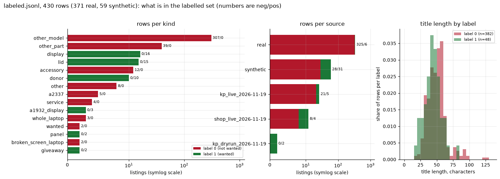
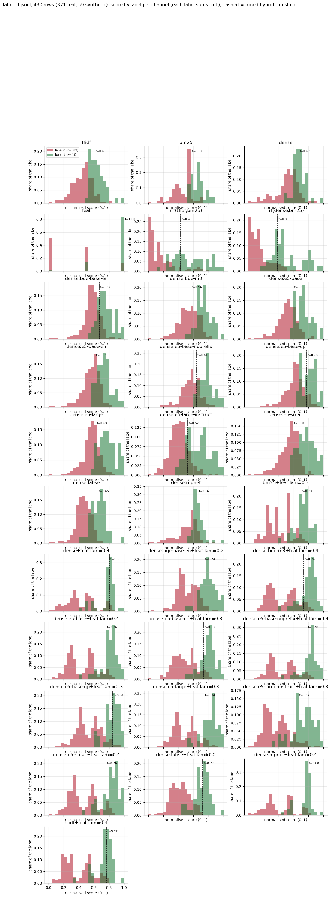
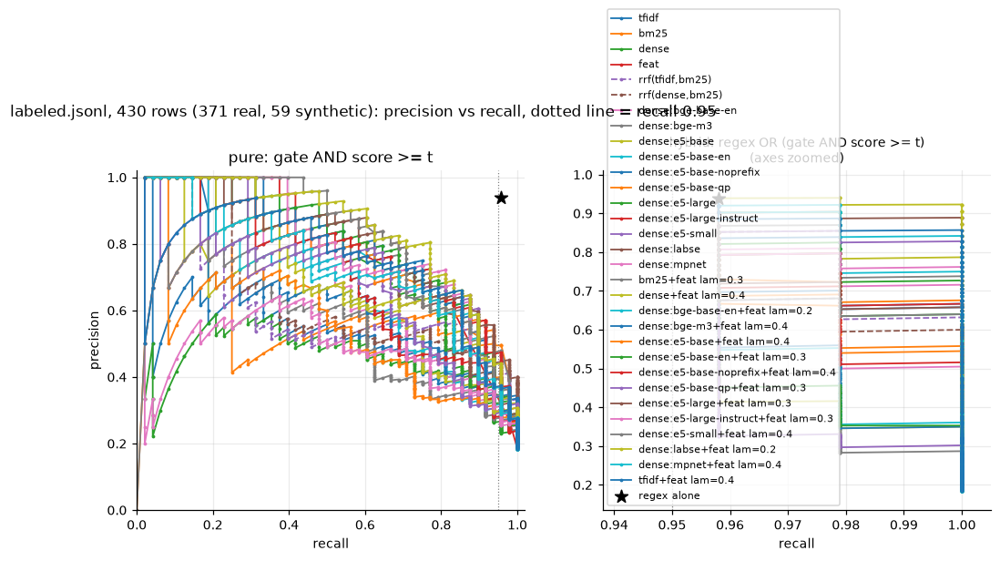
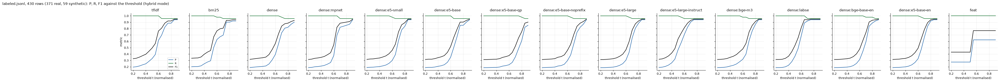
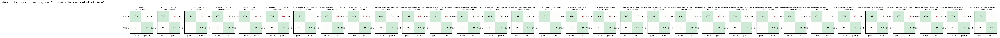
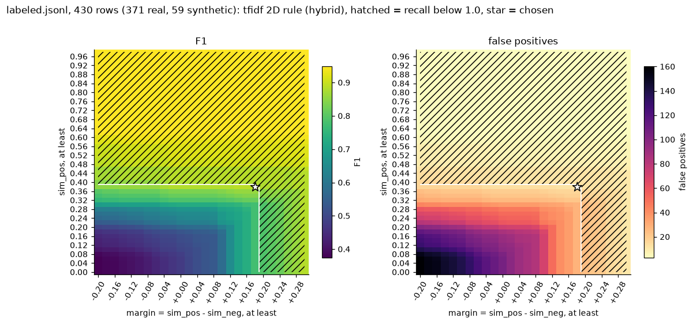
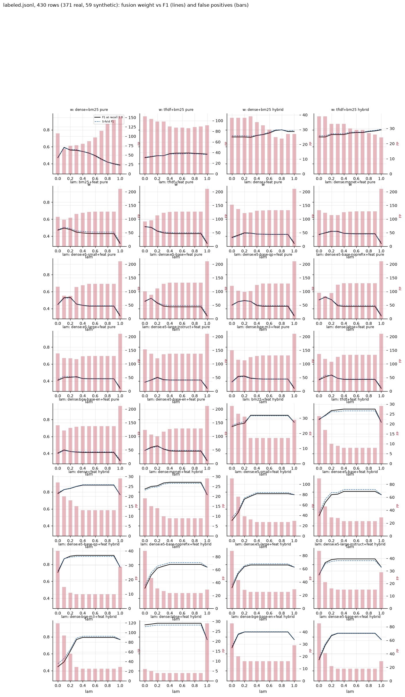
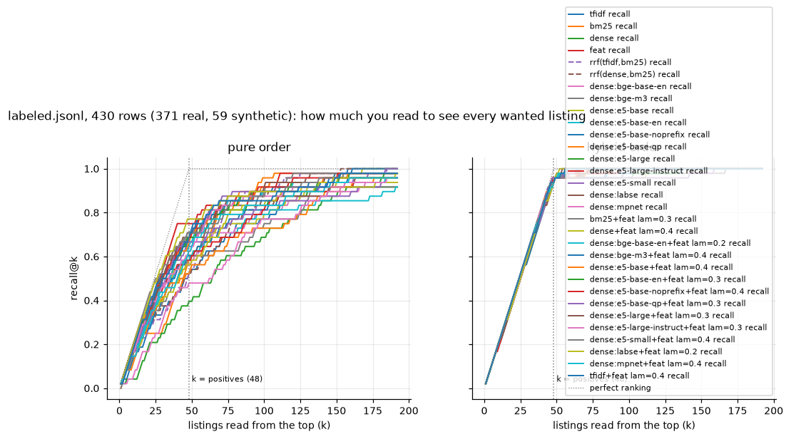
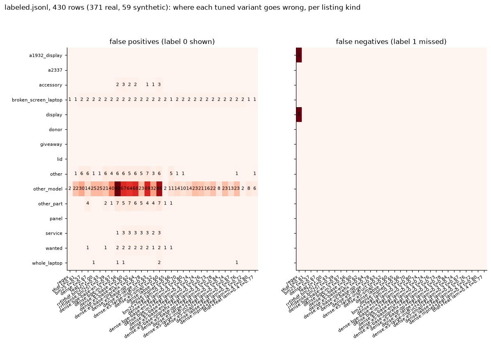

<!-- generated by python eval/plots.py, do not edit by hand -->

## Charts: labeled.jsonl, 430 rows (371 real, 59 synthetic)

### Ranking metrics (read the list from the top)

48 positives. pure = sorted by the score alone, hybrid = regex hits first, then rows the model gate lets through by score. R@n = recall after reading n listings, P@R1 / P@R95 = precision at the depth where recall reaches 1.0 / 0.95, depth@R1 = listings read to see all positives.

| channel | order | R@npos | R@2npos | P@R95 | P@R1 | depth@R1 | AP | nDCG@npos |
|---|---|---|---|---|---|---|---|---|
| tfidf | pure | 0.521 | 0.750 | 0.317 | 0.304 | 158 | 0.522 | 0.562 |
| tfidf | hybrid | 0.958 | 1.000 | 0.979 | 0.667 | 72 | 0.985 | 0.971 |
| bm25 | pure | 0.583 | 0.938 | 0.465 | 0.216 | 222 | 0.568 | 0.578 |
| bm25 | hybrid | 0.958 | 1.000 | 0.979 | 0.558 | 86 | 0.983 | 0.971 |
| dense | pure | 0.396 | 0.667 | 0.172 | 0.155 | 310 | 0.363 | 0.403 |
| dense | hybrid | 0.958 | 1.000 | 0.958 | 0.640 | 75 | 0.967 | 0.967 |
| feat | pure | 0.750 | 0.896 | 0.418 | 0.198 | 243 | 0.767 | 0.788 |
| feat | hybrid | 0.938 | 1.000 | 0.939 | 0.857 | 56 | 0.989 | 0.956 |
| rrf(tfidf,bm25) | pure | 0.521 | 0.896 | 0.404 | 0.259 | 185 | 0.579 | 0.569 |
| rrf(tfidf,bm25) | hybrid | 0.958 | 1.000 | 0.979 | 0.632 | 76 | 0.985 | 0.971 |
| rrf(dense,bm25) | pure | 0.521 | 0.833 | 0.357 | 0.314 | 153 | 0.612 | 0.609 |
| rrf(dense,bm25) | hybrid | 0.958 | 1.000 | 0.979 | 0.600 | 80 | 0.979 | 0.970 |
| dense:bge-base-en | pure | 0.562 | 0.792 | 0.221 | 0.172 | 279 | 0.618 | 0.639 |
| dense:bge-base-en | hybrid | 0.938 | 1.000 | 0.939 | 0.505 | 95 | 0.966 | 0.953 |
| dense:bge-m3 | pure | 0.583 | 0.729 | 0.209 | 0.162 | 297 | 0.596 | 0.660 |
| dense:bge-m3 | hybrid | 0.938 | 0.979 | 0.939 | 0.287 | 167 | 0.951 | 0.952 |
| dense:e5-base | pure | 0.604 | 0.771 | 0.305 | 0.286 | 168 | 0.629 | 0.668 |
| dense:e5-base | hybrid | 0.958 | 0.958 | 0.958 | 0.350 | 137 | 0.946 | 0.965 |
| dense:e5-base-en | pure | 0.583 | 0.792 | 0.198 | 0.185 | 259 | 0.612 | 0.658 |
| dense:e5-base-en | hybrid | 0.938 | 0.979 | 0.939 | 0.361 | 133 | 0.960 | 0.954 |
| dense:e5-base-noprefix | pure | 0.604 | 0.812 | 0.311 | 0.298 | 161 | 0.635 | 0.670 |
| dense:e5-base-noprefix | hybrid | 0.958 | 0.979 | 0.958 | 0.350 | 137 | 0.938 | 0.962 |
| dense:e5-base-qp | pure | 0.521 | 0.729 | 0.261 | 0.241 | 199 | 0.546 | 0.589 |
| dense:e5-base-qp | hybrid | 0.958 | 1.000 | 0.979 | 0.545 | 88 | 0.966 | 0.968 |
| dense:e5-large | pure | 0.667 | 0.833 | 0.303 | 0.190 | 253 | 0.728 | 0.738 |
| dense:e5-large | hybrid | 0.938 | 0.958 | 0.939 | 0.358 | 134 | 0.946 | 0.950 |
| dense:e5-large-instruct | pure | 0.583 | 0.792 | 0.220 | 0.169 | 284 | 0.652 | 0.667 |
| dense:e5-large-instruct | hybrid | 0.958 | 1.000 | 0.958 | 0.516 | 93 | 0.966 | 0.968 |
| dense:e5-small | pure | 0.646 | 0.833 | 0.232 | 0.220 | 218 | 0.692 | 0.721 |
| dense:e5-small | hybrid | 0.938 | 0.958 | 0.939 | 0.302 | 159 | 0.959 | 0.955 |
| dense:labse | pure | 0.667 | 0.833 | 0.282 | 0.173 | 278 | 0.754 | 0.747 |
| dense:labse | hybrid | 0.938 | 1.000 | 0.939 | 0.889 | 54 | 0.970 | 0.952 |
| dense:mpnet | pure | 0.479 | 0.750 | 0.232 | 0.202 | 238 | 0.410 | 0.474 |
| dense:mpnet | hybrid | 0.938 | 1.000 | 0.939 | 0.716 | 67 | 0.985 | 0.957 |
| bm25+feat lam=0.3 | pure | 0.688 | 0.875 | 0.397 | 0.220 | 218 | 0.686 | 0.683 |
| bm25+feat lam=0.3 | hybrid | 0.938 | 1.000 | 0.939 | 0.738 | 65 | 0.987 | 0.956 |
| dense+feat lam=0.4 | pure | 0.562 | 0.833 | 0.228 | 0.203 | 237 | 0.608 | 0.627 |
| dense+feat lam=0.4 | hybrid | 0.938 | 1.000 | 0.939 | 0.787 | 61 | 0.972 | 0.953 |
| dense:bge-base-en+feat lam=0.2 | pure | 0.646 | 0.875 | 0.250 | 0.198 | 243 | 0.690 | 0.700 |
| dense:bge-base-en+feat lam=0.2 | hybrid | 0.938 | 1.000 | 0.939 | 0.750 | 64 | 0.975 | 0.954 |
| dense:bge-m3+feat lam=0.4 | pure | 0.688 | 0.875 | 0.291 | 0.199 | 241 | 0.777 | 0.762 |
| dense:bge-m3+feat lam=0.4 | hybrid | 0.938 | 1.000 | 0.939 | 0.658 | 73 | 0.967 | 0.952 |
| dense:e5-base+feat lam=0.4 | pure | 0.667 | 0.896 | 0.326 | 0.198 | 242 | 0.762 | 0.743 |
| dense:e5-base+feat lam=0.4 | hybrid | 0.938 | 1.000 | 0.939 | 0.676 | 71 | 0.964 | 0.952 |
| dense:e5-base-en+feat lam=0.3 | pure | 0.688 | 0.896 | 0.254 | 0.224 | 214 | 0.733 | 0.749 |
| dense:e5-base-en+feat lam=0.3 | hybrid | 0.938 | 1.000 | 0.939 | 0.727 | 66 | 0.971 | 0.953 |
| dense:e5-base-noprefix+feat lam=0.4 | pure | 0.688 | 0.917 | 0.383 | 0.200 | 240 | 0.756 | 0.753 |
| dense:e5-base-noprefix+feat lam=0.4 | hybrid | 0.938 | 1.000 | 0.939 | 0.667 | 72 | 0.953 | 0.947 |
| dense:e5-base-qp+feat lam=0.3 | pure | 0.667 | 0.896 | 0.284 | 0.261 | 184 | 0.706 | 0.717 |
| dense:e5-base-qp+feat lam=0.3 | hybrid | 0.958 | 1.000 | 0.979 | 0.828 | 58 | 0.971 | 0.966 |
| dense:e5-large+feat lam=0.3 | pure | 0.708 | 0.896 | 0.324 | 0.226 | 212 | 0.759 | 0.768 |
| dense:e5-large+feat lam=0.3 | hybrid | 0.938 | 1.000 | 0.939 | 0.658 | 73 | 0.957 | 0.950 |
| dense:e5-large-instruct+feat lam=0.3 | pure | 0.625 | 0.875 | 0.249 | 0.202 | 238 | 0.696 | 0.695 |
| dense:e5-large-instruct+feat lam=0.3 | hybrid | 0.938 | 1.000 | 0.939 | 0.762 | 63 | 0.972 | 0.953 |
| dense:e5-small+feat lam=0.4 | pure | 0.708 | 0.875 | 0.333 | 0.214 | 224 | 0.796 | 0.783 |
| dense:e5-small+feat lam=0.4 | hybrid | 0.938 | 1.000 | 0.939 | 0.640 | 75 | 0.973 | 0.955 |
| dense:labse+feat lam=0.2 | pure | 0.771 | 0.896 | 0.311 | 0.224 | 214 | 0.824 | 0.827 |
| dense:labse+feat lam=0.2 | hybrid | 0.938 | 1.000 | 0.939 | 0.923 | 52 | 0.971 | 0.951 |
| dense:mpnet+feat lam=0.4 | pure | 0.625 | 0.833 | 0.289 | 0.211 | 227 | 0.625 | 0.667 |
| dense:mpnet+feat lam=0.4 | hybrid | 0.938 | 1.000 | 0.939 | 0.842 | 57 | 0.988 | 0.956 |
| tfidf+feat lam=0.4 | pure | 0.688 | 0.854 | 0.309 | 0.207 | 232 | 0.720 | 0.726 |
| tfidf+feat lam=0.4 | hybrid | 0.938 | 1.000 | 0.939 | 0.857 | 56 | 0.988 | 0.956 |

### Dense models side by side (EXP-003, H-30)

dense = sentence-transformers/paraphrase-multilingual-MiniLM-L12-v2, dense:<short> = eval/embedders.json. 95% bootstrap interval over 1000 row resamples (seed 0, scores fixed, nothing retuned).

| model | order | P@R1 | 95% CI | P@R95 | 95% CI | depth@R1 | nDCG@npos |
|---|---|---|---|---|---|---|---|
| dense:labse+feat lam=0.2 | hybrid | 0.923 | 0.849…1.000 | 0.939 | 0.867…1.000 | 52 | 0.951 |
| dense:labse | hybrid | 0.889 | 0.800…0.978 | 0.939 | 0.833…1.000 | 54 | 0.952 |
| dense:mpnet+feat lam=0.4 | hybrid | 0.842 | 0.750…0.981 | 0.939 | 0.800…1.000 | 57 | 0.956 |
| dense:e5-base-qp+feat lam=0.3 | hybrid | 0.828 | 0.736…1.000 | 0.979 | 0.768…1.000 | 58 | 0.966 |
| dense:e5-large-instruct+feat lam=0.3 | hybrid | 0.762 | 0.662…0.977 | 0.939 | 0.700…1.000 | 63 | 0.953 |
| dense:bge-base-en+feat lam=0.2 | hybrid | 0.750 | 0.652…0.977 | 0.939 | 0.698…1.000 | 64 | 0.954 |
| dense:e5-base-en+feat lam=0.3 | hybrid | 0.727 | 0.631…0.980 | 0.939 | 0.691…1.000 | 66 | 0.953 |
| dense:mpnet | hybrid | 0.716 | 0.615…0.964 | 0.939 | 0.655…1.000 | 67 | 0.957 |
| dense:e5-base+feat lam=0.4 | hybrid | 0.676 | 0.585…0.967 | 0.939 | 0.627…1.000 | 71 | 0.952 |
| dense:e5-base-noprefix+feat lam=0.4 | hybrid | 0.667 | 0.576…0.967 | 0.939 | 0.635…1.000 | 72 | 0.947 |
| dense:bge-m3+feat lam=0.4 | hybrid | 0.658 | 0.561…0.962 | 0.939 | 0.610…1.000 | 73 | 0.952 |
| dense:e5-large+feat lam=0.3 | hybrid | 0.658 | 0.560…0.962 | 0.939 | 0.600…1.000 | 73 | 0.950 |
| dense | hybrid | 0.640 | 0.543…0.979 | 0.958 | 0.586…1.000 | 75 | 0.967 |
| dense:e5-small+feat lam=0.4 | hybrid | 0.640 | 0.550…0.964 | 0.939 | 0.582…1.000 | 75 | 0.955 |
| dense:e5-base-qp | hybrid | 0.545 | 0.458…1.000 | 0.979 | 0.495…1.000 | 88 | 0.968 |
| dense:e5-large-instruct | hybrid | 0.516 | 0.429…0.979 | 0.958 | 0.464…1.000 | 93 | 0.968 |
| dense:bge-base-en | hybrid | 0.505 | 0.418…0.976 | 0.939 | 0.451…1.000 | 95 | 0.953 |
| dense:e5-base-en | hybrid | 0.361 | 0.290…0.980 | 0.939 | 0.324…1.000 | 133 | 0.954 |
| dense:e5-large | hybrid | 0.358 | 0.288…0.962 | 0.939 | 0.311…1.000 | 134 | 0.950 |
| dense:e5-base | hybrid | 0.350 | 0.291…0.978 | 0.958 | 0.317…1.000 | 137 | 0.965 |
| dense:e5-base-noprefix | hybrid | 0.350 | 0.292…0.978 | 0.958 | 0.316…1.000 | 137 | 0.962 |
| dense:e5-small | hybrid | 0.302 | 0.245…0.962 | 0.939 | 0.260…1.000 | 159 | 0.955 |
| dense:bge-m3 | hybrid | 0.287 | 0.229…0.962 | 0.939 | 0.257…1.000 | 167 | 0.952 |
| dense:e5-base-noprefix | pure | 0.298 | 0.238…0.378 | 0.311 | 0.237…0.441 | 161 | 0.670 |
| dense:e5-base | pure | 0.286 | 0.230…0.368 | 0.305 | 0.233…0.401 | 168 | 0.668 |
| dense:e5-base-qp+feat lam=0.3 | pure | 0.261 | 0.209…0.351 | 0.284 | 0.216…0.628 | 184 | 0.717 |
| dense:e5-base-qp | pure | 0.241 | 0.191…0.313 | 0.261 | 0.192…0.357 | 199 | 0.589 |
| dense:e5-large+feat lam=0.3 | pure | 0.226 | 0.178…0.438 | 0.324 | 0.184…0.583 | 212 | 0.768 |
| dense:e5-base-en+feat lam=0.3 | pure | 0.224 | 0.178…0.385 | 0.254 | 0.186…0.531 | 214 | 0.749 |
| dense:labse+feat lam=0.2 | pure | 0.224 | 0.176…0.354 | 0.311 | 0.192…0.583 | 214 | 0.827 |
| dense:e5-small | pure | 0.220 | 0.175…0.287 | 0.232 | 0.177…0.341 | 218 | 0.721 |
| dense:e5-small+feat lam=0.4 | pure | 0.214 | 0.172…0.393 | 0.333 | 0.198…0.500 | 224 | 0.783 |
| dense:mpnet+feat lam=0.4 | pure | 0.211 | 0.169…0.342 | 0.289 | 0.179…0.409 | 227 | 0.667 |
| dense:mpnet | pure | 0.202 | 0.158…0.299 | 0.232 | 0.160…0.359 | 238 | 0.474 |
| dense:e5-large-instruct+feat lam=0.3 | pure | 0.202 | 0.161…0.311 | 0.249 | 0.172…0.523 | 238 | 0.695 |
| dense:e5-base-noprefix+feat lam=0.4 | pure | 0.200 | 0.161…0.438 | 0.383 | 0.185…0.551 | 240 | 0.753 |
| dense:bge-m3+feat lam=0.4 | pure | 0.199 | 0.159…0.369 | 0.291 | 0.180…0.518 | 241 | 0.762 |
| dense:bge-base-en+feat lam=0.2 | pure | 0.198 | 0.156…0.383 | 0.250 | 0.171…0.540 | 243 | 0.700 |
| dense:e5-base+feat lam=0.4 | pure | 0.198 | 0.159…0.448 | 0.326 | 0.183…0.538 | 242 | 0.743 |
| dense:e5-large | pure | 0.190 | 0.151…0.361 | 0.303 | 0.180…0.414 | 253 | 0.738 |
| dense:e5-base-en | pure | 0.185 | 0.144…0.244 | 0.198 | 0.150…0.293 | 259 | 0.658 |
| dense:labse | pure | 0.173 | 0.136…0.325 | 0.282 | 0.156…0.420 | 278 | 0.747 |
| dense:bge-base-en | pure | 0.172 | 0.135…0.281 | 0.221 | 0.138…0.367 | 279 | 0.639 |
| dense:e5-large-instruct | pure | 0.169 | 0.134…0.289 | 0.220 | 0.153…0.422 | 284 | 0.667 |
| dense:bge-m3 | pure | 0.162 | 0.128…0.284 | 0.209 | 0.141…0.364 | 297 | 0.660 |
| dense | pure | 0.155 | 0.118…0.242 | 0.172 | 0.121…0.338 | 310 | 0.403 |

### 01_dataset

What the labelled set holds: rows per kind and source split by label, title length by label.

### 02_score_hist

Raw score distribution by label per channel. Overlap = rows no threshold can separate.

### 03_pr_curves

Precision against recall when the threshold slides. Star = regex alone.

### 04_threshold

How P, R and F1 move with the threshold (hybrid). The flat P line is where the regex dominates.

### 05_confusion

Confusion matrix per variant at the threshold the sweep picked (recall first).

### 06_tfidf_2d

The monitor's own tfidf rule over its full grid: how pos and margin interact. Hatched cells miss a positive, the white line bounds recall 1.0, the star is the setting the sweep picked.

### 07_fusion_weights

Fusion weight against F1 (black), 5-fold F1 (blue dashed) and false positives (bars).

### 08_recall_budget

Recall when you read the top k listings. The dotted line is k = number of positives.

### 09_errors_by_kind

Errors per listing kind, which kinds each channel confuses with the product.

